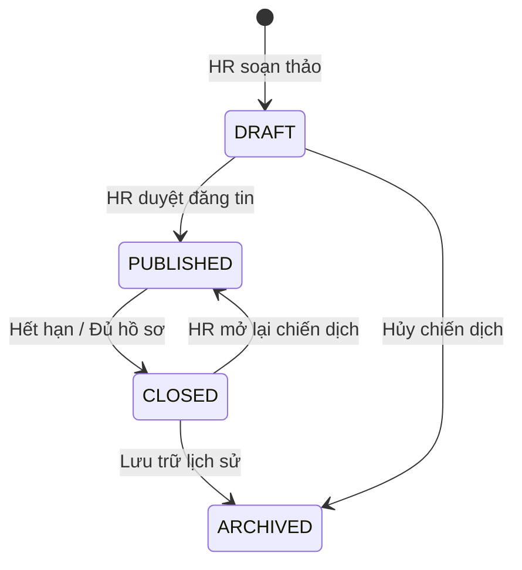
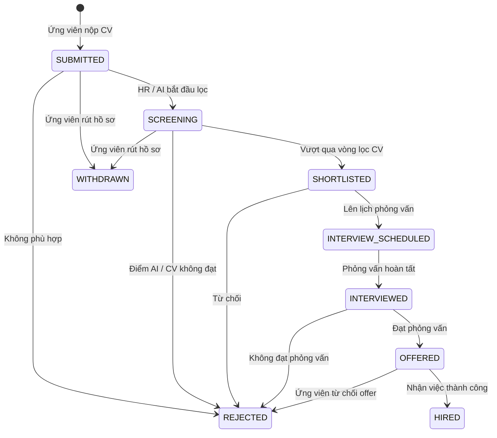
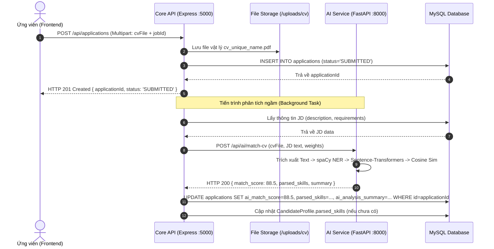

# TÀI LIỆU HỢP ĐỒNG API (API CONTRACT SPECIFICATION)

---

## 1. QUY CHUẨN THIẾT KẾ CHUNG (GENERAL CONVENTIONS)

Tài liệu này xác lập hợp đồng giao tiếp chuẩn giữa **Frontend (Next.js)**, **Backend (Core Express API)** và **AI Service (Python FastAPI)**.

### 1.1. Base URLs & Cổng dịch vụ
- **Core Backend API (Express.js)**: `http://localhost:5000/api`
- **AI Microservice (FastAPI)**: `http://localhost:8000/api/ai` (chỉ gọi nội bộ từ Core Backend)
- **Frontend App (Next.js)**: `http://localhost:3000`

### 1.2. Chuẩn Header & Xác thực
- **Content-Type**:
  - `application/json` đối với các yêu cầu dữ liệu tiêu chuẩn.
  - `multipart/form-data` đối với các yêu cầu tải lên tệp tin CV (`.pdf`, `.docx`).
- **Authorization**: `Bearer <JWT_TOKEN>` được đính kèm trong HTTP Request Header đối với các endpoint yêu cầu xác thực.

### 1.3. Cấu trúc phản hồi JSON chuẩn (Response Envelopes)

#### Phản hồi thành công (Success Response):
```json
{
  "success": true,
  "data": { ... },
  "message": "Mô tả kết quả thực hiện thành công (tùy chọn)",
  "meta": {
    "page": 1,
    "limit": 10,
    "total": 45,
    "totalPages": 5
  }
}
```

#### Phản hồi thất bại (Error Response):
```json
{
  "success": false,
  "error": {
    "code": "VALIDATION_ERROR",
    "message": "Dữ liệu gửi lên không hợp lệ",
    "details": [
      {
        "field": "email",
        "message": "Email không đúng định dạng"
      }
    ]
  }
}
```

### 1.4. Bảng mã trạng thái HTTP chuẩn (Standard HTTP Status Codes)
| Mã HTTP | Tên mã | Ý nghĩa & Ứng dụng |
|---|---|---|
| `200 OK` | Thành công | Dữ liệu được truy vấn, cập nhật hoặc xóa thành công |
| `201 Created` | Đã khởi tạo | Tài nguyên mới (User, Job, Application, Interview) được tạo thành công |
| `400 Bad Request` | Lỗi dữ liệu | Request body/query sai định dạng hoặc vi phạm validation schema |
| `401 Unauthorized` | Chưa xác thực | Không có JWT token, token hết hạn hoặc không hợp lệ |
| `403 Forbidden` | Không có quyền | Token hợp lệ nhưng Role không đủ quyền truy cập tài nguyên |
| `404 Not Found` | Không tìm thấy | ID tài nguyên không tồn tại trong CSDL |
| `409 Conflict` | Xung đột dữ liệu | Trùng lặp email hoặc đã nộp đơn vào tin tuyển dụng này rồi |
| `413 Payload Too Large` | Dung lượng vượt mức | File CV tải lên vượt quá giới hạn cho phép (> 5MB) |
| `415 Unsupported Media` | Sai định dạng tệp | Tệp CV không phải là định dạng `.pdf` hoặc `.docx` |
| `500 Internal Error` | Lỗi máy chủ | Lỗi ngoại lệ chưa được xử lý tại Backend |
| `503 Service Unavailable` | Dịch vụ ngoại vi gián đoạn | AI Service không phản hồi hoặc mất kết nối |

---

## 2. THỐNG NHẤT HỆ THỐNG TRẠNG THÁI NGHIỆP VỤ (STATE MACHINES)

### 2.1. Trạng thái tin tuyển dụng (`JobStatus`)
Các trạng thái vòng đời của một tin tuyển dụng:
- `DRAFT`: Tin vừa được HR soạn thảo, chưa công khai cho ứng viên.
- `PUBLISHED`: Tin đang mở, hiển thị công khai trên cổng việc làm để ứng viên nộp hồ sơ.
- `CLOSED`: Tin đã đóng tiếp nhận hồ sơ (đã đủ chỉ tiêu hoặc hết hạn nộp).
- `ARCHIVED`: Tin đã hoàn tất chiến dịch tuyển dụng, lưu trữ dữ liệu lịch sử.



### 2.2. Trạng thái hồ sơ ứng tuyển (`ApplicationStatus`)
Quản lý tiến trình xử lý hồ sơ ứng viên qua các vòng phễu tuyển dụng:
- `SUBMITTED`: Ứng viên mới nộp đơn và tải lên CV thành công.
- `SCREENING`: Hồ sơ đang trong vòng sàng lọc (chờ duyệt hoặc đang chạy phân tích AI).
- `SHORTLISTED`: Hồ sơ đạt tiêu chuẩn vòng lọc (được HR chọn đi tiếp vào vòng phỏng vấn).
- `INTERVIEW_SCHEDULED`: Ứng viên đã được xếp lịch phỏng vấn chính thức.
- `INTERVIEWED`: Buổi phỏng vấn đã kết thúc, chờ hội đồng đánh giá cho điểm.
- `OFFERED`: Doanh nghiệp gửi thư mời nhận việc (Job Offer).
- `HIRED`: Ứng viên đồng ý nhận việc, tuyển dụng thành công.
- `REJECTED`: Hồ sơ bị từ chối ở bất kỳ vòng nào.
- `WITHDRAWN`: Ứng viên chủ động rút đơn ứng tuyển (khi hồ sơ chưa được chốt kết quả).



### 2.3. Trạng thái phân tích AI (`AIStatus`)
Tiến trình xử lý tính toán của AI Microservice đối với từng hồ sơ:
- `IDLE`: Hồ sơ mới, chưa kích hoạt chạy AI.
- `PENDING`: Đã gửi yêu cầu vào hàng đợi xử lý.
- `PROCESSING`: AI Service đang trích xuất text, bóc tách thực thể và tính vector tương đồng.
- `COMPLETED`: Đã tính xong điểm tương đồng, bóc tách kỹ năng và tóm tắt nhận xét thành công.
- `FAILED`: Lỗi đọc tệp CV, lỗi timeout hoặc AI Service không phản hồi.

### 2.4. Trạng thái lịch phỏng vấn (`InterviewStatus`)
- `SCHEDULED`: Lịch phỏng vấn đã được thiết lập và thông báo cho các bên.
- `COMPLETED`: Buổi phỏng vấn đã diễn ra thành công và đã có đánh giá/feedback.
- `CANCELLED`: Lịch phỏng vấn bị hủy bỏ trước giờ hẹn.
- `NO_SHOW`: Ứng viên vắng mặt không lý do.

---

## 3. CHI TIẾT HỢP ĐỒNG API CHO TỪNG MODULE (CORE API)

### 3.1. MODULE AUTHENTICATION & USER PROFILE

#### 3.1.1. Đăng ký tài khoản
- **Endpoint**: `POST /api/auth/register`
- **Quyền truy cập**: Public
- **Request Body**:
```json
{
  "email": "candidate@example.com",
  "password": "Password123@",
  "firstName": "Nguyễn Văn",
  "lastName": "An",
  "role": "CANDIDATE" 
}
```
*Validation*:
  - `email`: Bắt buộc, định dạng email hợp lệ.
  - `password`: Bắt buộc, tối thiểu 6 ký tự.
  - `firstName`, `lastName`: Bắt buộc, không được để trống.
  - `role`: Tùy chọn, mặc định `'CANDIDATE'`. Chỉ cho phép `'CANDIDATE'` hoặc `'HR'`.
- **Response `201 Created`**:
```json
{
  "success": true,
  "message": "Đăng ký tài khoản thành công",
  "data": {
    "user": {
      "id": "c1f7a2d8-912b-489e-9d0a-4229e612abcd",
      "email": "candidate@example.com",
      "firstName": "Nguyễn Văn",
      "lastName": "An",
      "role": "CANDIDATE",
      "createdAt": "2026-10-11T08:00:00.000Z"
    },
    "token": "eyJhbGciOiJIUzI1NiIsInR5cCI6IkpXVCJ9..."
  }
}
```
- **Mã lỗi**: `400 Bad Request` (Dữ liệu không hợp lệ), `409 Conflict` (Email đã tồn tại).

---

#### 3.1.2. Đăng nhập hệ thống
- **Endpoint**: `POST /api/auth/login`
- **Quyền truy cập**: Public
- **Request Body**:
```json
{
  "email": "candidate@example.com",
  "password": "Password123@"
}
```
- **Response `200 OK`**:
```json
{
  "success": true,
  "message": "Đăng nhập thành công",
  "data": {
    "user": {
      "id": "c1f7a2d8-912b-489e-9d0a-4229e612abcd",
      "email": "candidate@example.com",
      "firstName": "Nguyễn Văn",
      "lastName": "An",
      "role": "CANDIDATE",
      "avatarUrl": null
    },
    "token": "eyJhbGciOiJIUzI1NiIsInR5cCI6IkpXVCJ9..."
  }
}
```
- **Mã lỗi**: `401 Unauthorized` (Sai email hoặc mật khẩu, hoặc tài khoản bị khóa `isActive = false`).

---

#### 3.1.3. Lấy thông tin người dùng hiện tại
- **Endpoint**: `GET /api/auth/me`
- **Quyền truy cập**: Authenticated (`ADMIN`, `HR`, `CANDIDATE`)
- **Headers**: `Authorization: Bearer <token>`
- **Response `200 OK`**:
```json
{
  "success": true,
  "data": {
    "id": "c1f7a2d8-912b-489e-9d0a-4229e612abcd",
    "email": "candidate@example.com",
    "firstName": "Nguyễn Văn",
    "lastName": "An",
    "role": "CANDIDATE",
    "avatarUrl": null,
    "candidateProfile": {
      "id": "e4f8b910-44bb-4e67-8541-1123456789ab",
      "phone": "0987654321",
      "dateOfBirth": "2000-05-15T00:00:00.000Z",
      "address": "Cầu Giấy, Hà Nội",
      "summary": "Fullstack Developer với 2 năm kinh nghiệm Node.js và React",
      "cvFileUrl": "/uploads/cv/cv_candidate_default.pdf",
      "parsedSkills": ["Node.js", "TypeScript", "React", "MySQL"],
      "experienceYears": 2,
      "education": "Đại học Công nghệ Giao thông Vận tải"
    }
  }
}
```
- **Mã lỗi**: `401 Unauthorized`.

---

#### 3.1.4. Cập nhật hồ sơ ứng viên
- **Endpoint**: `PUT /api/candidates/profile`
- **Quyền truy cập**: Role `CANDIDATE`
- **Request Body**:
```json
{
  "phone": "0987654321",
  "dateOfBirth": "2000-05-15",
  "address": "Cầu Giấy, Hà Nội",
  "summary": "Fullstack Developer 2 năm kinh nghiệm",
  "experienceYears": 2,
  "education": "Đại học Công nghệ GTVT"
}
```
- **Response `200 OK`**: Trả về `CandidateProfile` đã cập nhật.

---

#### 3.1.5. Đổi mật khẩu
- **Endpoint**: `PUT /api/auth/change-password`
- **Quyền truy cập**: Authenticated (`ADMIN`, `HR`, `CANDIDATE`)
- **Headers**: `Authorization: Bearer <token>`
- **Request Body**:
```json
{
  "currentPassword": "OldPassword123@",
  "newPassword": "NewPassword456@"
}
```
*Validation*:
  - `currentPassword`: Bắt buộc, khớp với mật khẩu hiện tại.
  - `newPassword`: Bắt buộc, tối thiểu 6 ký tự, không được trùng mật khẩu cũ.
- **Response `200 OK`**:
```json
{
  "success": true,
  "message": "Đổi mật khẩu thành công"
}
```
- **Mã lỗi**: `400 Bad Request`, `401 Unauthorized`.

---

#### 3.1.6. Yêu cầu đặt lại mật khẩu (Quên mật khẩu)
- **Endpoint**: `POST /api/auth/forgot-password`
- **Quyền truy cập**: Public
- **Request Body**:
```json
{
  "email": "candidate@example.com"
}
```
*Validation*:
  - `email`: Bắt buộc, định dạng email hợp lệ.
- **Response `200 OK`**: (Luôn trả thông báo trung lập, bảo vệ danh tính người dùng)
```json
{
  "success": true,
  "message": "Nếu email tồn tại trong hệ thống, hướng dẫn đặt lại mật khẩu đã được gửi đến hộp thư của bạn."
}
```
- **Mã lỗi**: `400 Bad Request` (Email không hợp lệ), `429 Too Many Requests` (Gửi quá nhiều yêu cầu trong thời gian ngắn).

---

#### 3.1.7. Đặt lại mật khẩu mới
- **Endpoint**: `POST /api/auth/reset-password`
- **Quyền truy cập**: Public
- **Request Body**:
```json
{
  "token": "4a8c9b2f... (chuỗi hex 64 ký tự)",
  "newPassword": "NewSecurePassword123@"
}
```
*Validation*:
  - `token`: Bắt buộc.
  - `newPassword`: Bắt buộc, tối thiểu 6 ký tự (đồng bộ với quy tắc đăng ký tài khoản).
- **Response `200 OK`**:
```json
{
  "success": true,
  "message": "Đặt lại mật khẩu thành công. Vui lòng đăng nhập bằng mật khẩu mới."
}
```
- **Mã lỗi**: `400 Bad Request` (Token không hợp lệ, token hết hạn, token đã sử dụng, hoặc mật khẩu mới vi phạm validation).

---

### 3.2. MODULE QUẢN LÝ TIN TUYỂN DỤNG (JOB POSTINGS)

#### 3.2.1. Lấy danh sách tin tuyển dụng (Công khai / Tìm kiếm)
- **Endpoint**: `GET /api/jobs`
- **Quyền truy cập**: Public
- **Query Parameters**:
  - `page`: Số trang (mặc định: `1`)
  - `limit`: Số bản ghi mỗi trang (mặc định: `10`)
  - `search`: Từ khóa tìm kiếm theo `title`
  - `department`: Lọc theo phòng ban (ví dụ: `IT`, `Marketing`)
  - `location`: Lọc theo địa điểm (ví dụ: `Hà Nội`, `Remote`)
  - `employmentType`: Lọc hình thức (`FULL_TIME`, `PART_TIME`, `INTERNSHIP`)
  - *Lưu ý*: Với khách vãng lai và ứng viên, hệ thống luôn tự động ép điều kiện `status = PUBLISHED`.
- **Response `200 OK`**:
```json
{
  "success": true,
  "data": [
    {
      "id": "j9a8b7c6-11aa-22bb-33cc-44dd55ee66ff",
      "title": "Senior Frontend Developer (React/Next.js)",
      "department": "Kỹ thuật Công nghệ",
      "location": "Hà Nội (Hybrid)",
      "employmentType": "FULL_TIME",
      "salaryMin": 25000000,
      "salaryMax": 40000000,
      "status": "PUBLISHED",
      "applicationDeadline": "2026-11-30T23:59:59.000Z",
      "postedBy": {
        "firstName": "Trần",
        "lastName": "Linh",
        "email": "hr@company.com"
      },
      "createdAt": "2026-10-01T10:00:00.000Z"
    }
  ],
  "meta": {
    "page": 1,
    "limit": 10,
    "total": 15,
    "totalPages": 2
  }
}
```

---

#### 3.2.2. Lấy chi tiết tin tuyển dụng
- **Endpoint**: `GET /api/jobs/:id`
- **Quyền truy cập**: Public
- **Response `200 OK`**:
```json
{
  "success": true,
  "data": {
    "id": "j9a8b7c6-11aa-22bb-33cc-44dd55ee66ff",
    "title": "Senior Frontend Developer (React/Next.js)",
    "department": "Kỹ thuật Công nghệ",
    "location": "Hà Nội (Hybrid)",
    "employmentType": "FULL_TIME",
    "description": "Tham gia phát triển hệ thống quản lý tuyển dụng nội bộ...",
    "requirements": "Thành thạo React, Next.js, TypeScript. Tối thiểu 3 năm kinh nghiệm...",
    "salaryMin": 25000000,
    "salaryMax": 40000000,
    "status": "PUBLISHED",
    "applicationDeadline": "2026-11-30T23:59:59.000Z",
    "createdAt": "2026-10-01T10:00:00.000Z"
  }
}
```
- **Mã lỗi**: `404 Not Found` (Tin không tồn tại).

---

#### 3.2.3. Tạo tin tuyển dụng mới
- **Endpoint**: `POST /api/jobs`
- **Quyền truy cập**: Role `HR`, `ADMIN`
- **Request Body**:
```json
{
  "title": "AI/NLP Engineer (Python/FastAPI)",
  "department": "AI Research Lab",
  "location": "Hà Nội",
  "employmentType": "FULL_TIME",
  "description": "Xây dựng các giải pháp trích xuất văn bản và mô hình ngôn ngữ lớn...",
  "requirements": "Thành thạo Python, spaCy, PyTorch hoặc Sentence-Transformers...",
  "salaryMin": 20000000,
  "salaryMax": 35000000,
  "status": "DRAFT",
  "applicationDeadline": "2026-12-15T23:59:59.000Z"
}
```
*Validation*:
  - `title`, `description`: Bắt buộc.
  - `salaryMin`, `salaryMax`: Số dương, `salaryMin <= salaryMax`.
  - `status`: Phải thuộc `['DRAFT', 'PUBLISHED']`.
- **Response `201 Created`**: Trả về bản ghi JobPosting vừa tạo.

---

#### 3.2.4. Cập nhật trạng thái tin tuyển dụng
- **Endpoint**: `PATCH /api/jobs/:id/status`
- **Quyền truy cập**: Role `HR`, `ADMIN`
- **Request Body**:
```json
{
  "status": "CLOSED" 
}
```
*Validation*: `status` thuộc `['DRAFT', 'PUBLISHED', 'CLOSED', 'ARCHIVED']`.
- **Response `200 OK`**: Trả về JobPosting đã cập nhật trạng thái.

---

### 3.3. MODULE HỒ SƠ ỨNG TUYỂN (APPLICATIONS)

#### 3.3.1. Ứng viên nộp hồ sơ ứng tuyển (Kèm tệp CV)
- **Endpoint**: `POST /api/applications`
- **Quyền truy cập**: Role `CANDIDATE`
- **Content-Type**: `multipart/form-data`
- **Form Data Fields**:
  - `jobPostingId`: `string` (UUID v4 của Job, Bắt buộc)
  - `coverLetter`: `string` (Thư giới thiệu, Tùy chọn)
  - `cvFile`: `File` (.pdf hoặc .docx, tối đa 5MB, Tùy chọn nếu hồ sơ đã có CV trước đó)
- **Xử lý tại Backend**:
  - Kiểm tra `JobPosting` có đang ở trạng thái `PUBLISHED` và chưa quá hạn nộp không.
  - Kiểm tra xem ứng viên đã từng nộp vào Job này chưa (ngăn trùng lặp qua unique constraint).
  - Multer lưu tệp vào `uploads/cv/cv_{userId}_{timestamp}.pdf`.
  - Khởi tạo bản ghi `Application` với trạng thái `SUBMITTED`.
  - Tự động gọi sang AI Service để chạy phân tích ngầm (Background Task).
- **Response `201 Created`**:
```json
{
  "success": true,
  "message": "Nộp hồ sơ ứng tuyển thành công",
  "data": {
    "applicationId": "a1b2c3d4-55ee-66ff-77aa-88bb99cc0011",
    "jobPostingId": "j9a8b7c6-11aa-22bb-33cc-44dd55ee66ff",
    "status": "SUBMITTED",
    "appliedAt": "2026-10-11T09:30:00.000Z"
  }
}
```
- **Mã lỗi**: `400 Bad Request`, `409 Conflict` (Bạn đã nộp hồ sơ vào vị trí này rồi), `413 Payload Too Large`, `415 Unsupported Media Type`.

---

#### 3.3.2. Ứng viên xem lịch sử các đơn đã nộp
- **Endpoint**: `GET /api/applications/my-applications`
- **Quyền truy cập**: Role `CANDIDATE`
- **Response `200 OK`**:
```json
{
  "success": true,
  "data": [
    {
      "id": "a1b2c3d4-55ee-66ff-77aa-88bb99cc0011",
      "status": "INTERVIEW_SCHEDULED",
      "appliedAt": "2026-10-05T09:30:00.000Z",
      "jobPosting": {
        "id": "j9a8b7c6-11aa-22bb-33cc-44dd55ee66ff",
        "title": "Senior Frontend Developer (React/Next.js)",
        "department": "Kỹ thuật Công nghệ",
        "location": "Hà Nội"
      },
      "interview": {
        "scheduledAt": "2026-10-15T14:00:00.000Z",
        "meetingUrl": "https://meet.google.com/abc-xyz-ats"
      }
    }
  ]
}
```

---

#### 3.3.3. Ứng viên rút đơn ứng tuyển
- **Endpoint**: `PUT /api/applications/:id/withdraw`
- **Quyền truy cập**: Role `CANDIDATE` (Chỉ rút được đơn của chính mình)
- **Điều kiện**: Đơn đang ở trạng thái `SUBMITTED` hoặc `SCREENING`.
- **Response `200 OK`**: Cập nhật `status = WITHDRAWN`.

---

#### 3.3.4. HR xem danh sách hồ sơ ứng tuyển theo tin (Ranking AI)
- **Endpoint**: `GET /api/applications/job/:jobId`
- **Quyền truy cập**: Role `HR`, `ADMIN`
- **Query Parameters**:
  - `status`: Lọc theo trạng thái hồ sơ (ví dụ: `SCREENING`, `SHORTLISTED`)
  - `sortBy`: `aiMatchScore` (mặc định) hoặc `appliedAt`
  - `order`: `desc` hoặc `asc`
  - `minScore`: Lọc điểm AI tối thiểu (ví dụ: `70`)
- **Response `200 OK`**:
```json
{
  "success": true,
  "data": [
    {
      "id": "a1b2c3d4-55ee-66ff-77aa-88bb99cc0011",
      "status": "SCREENING",
      "appliedAt": "2026-10-10T14:20:00.000Z",
      "aiMatchScore": 88.5,
      "parsedSkills": ["React", "Next.js", "TypeScript", "Tailwind CSS", "Redux"],
      "candidate": {
        "fullName": "Nguyễn Văn An",
        "email": "candidate@example.com",
        "phone": "0987654321",
        "experienceYears": 3,
        "education": "Đại học Bách Khoa"
      }
    }
  ]
}
```

---

#### 3.3.5. HR cập nhật trạng thái hồ sơ ứng viên
- **Endpoint**: `PATCH /api/applications/:id/status`
- **Quyền truy cập**: Role `HR`, `ADMIN`
- **Request Body**:
```json
{
  "status": "SHORTLISTED"
}
```
*Validation*: `status` thuộc `ApplicationStatus`.
- **Response `200 OK`**: Trả về Application đã đổi trạng thái và tự động tạo Notification gửi ứng viên.

---

### 3.4. MODULE SÀNG LỌC & TÍNH ĐIỂM AI (AI SCREENING & RANKING)

#### 3.4.1. HR kích hoạt chấm điểm AI lại cho 1 hồ sơ
- **Endpoint**: `POST /api/ai/screen/:applicationId`
- **Quyền truy cập**: Role `HR`, `ADMIN`
- **Request Body** (Tùy chỉnh trọng số điểm):
```json
{
  "weights": {
    "skillWeight": 0.5,
    "expWeight": 0.3,
    "semanticWeight": 0.2
  }
}
```
- **Response `200 OK`**:
```json
{
  "success": true,
  "message": "Phân tích AI hoàn tất",
  "data": {
    "applicationId": "a1b2c3d4-55ee-66ff-77aa-88bb99cc0011",
    "aiMatchScore": 88.5,
    "scoreDetails": {
      "skillScore": 90.0,
      "expScore": 85.0,
      "semanticScore": 89.2
    },
    "parsedSkills": ["React", "Next.js", "TypeScript", "Node.js"],
    "matchedSkills": ["React", "Next.js", "TypeScript"],
    "missingSkills": ["GraphQL", "Docker"],
    "aiAnalysisSummary": "Ứng viên có nền tảng vững chắc về React và TypeScript, kỹ năng đáp ứng 85% yêu cầu. Kinh nghiệm 3 năm phù hợp với vị trí."
  }
}
```

---

#### 3.4.2. HR chạy xếp hạng AI hàng loạt cho toàn bộ chiến dịch tuyển dụng
- **Endpoint**: `POST /api/ai/batch-screen/:jobId`
- **Quyền truy cập**: Role `HR`, `ADMIN`
- **Request Body**:
```json
{
  "weights": {
    "skillWeight": 0.6,
    "expWeight": 0.4,
    "semanticWeight": 0.0
  }
}
```
- **Response `200 OK`**:
```json
{
  "success": true,
  "message": "Đã hoàn thành phân tích và xếp hạng 12 hồ sơ",
  "data": {
    "totalProcessed": 12,
    "averageScore": 76.4,
    "topCandidates": [
      {
        "applicationId": "a1b2c3d4-...",
        "candidateName": "Nguyễn Văn An",
        "aiMatchScore": 92.0
      }
    ]
  }
}
```

---

### 3.5. MODULE QUẢN LÝ LỊCH PHỎNG VẤN (INTERVIEWS)

#### 3.5.1. Tạo lịch phỏng vấn mới
- **Endpoint**: `POST /api/interviews`
- **Quyền truy cập**: Role `HR`, `ADMIN`
- **Request Body**:
```json
{
  "applicationId": "a1b2c3d4-55ee-66ff-77aa-88bb99cc0011",
  "interviewerId": "u8b7c6d5-11aa-22bb-33cc-44dd55ee6677",
  "scheduledAt": "2026-10-20T14:30:00.000Z",
  "durationMinutes": 60,
  "location": "Phòng họp 302, Tòa nhà A",
  "meetingUrl": "https://meet.google.com/xyz-ats-interview",
  "notes": "Phỏng vấn chuyên sâu kỹ thuật React & System Design"
}
```
*Tác vụ kèm theo*: Tự động cập nhật `Application.status = INTERVIEW_SCHEDULED`.
- **Response `201 Created`**: Trả về bản ghi `Interview` vừa tạo.

---

#### 3.5.2. Cập nhật kết quả đánh giá phỏng vấn
- **Endpoint**: `PATCH /api/interviews/:id/feedback`
- **Quyền truy cập**: Role `HR`, `ADMIN`
- **Request Body**:
```json
{
  "rating": 5,
  "feedback": "Ứng viên nắm chắc kiến trúc React, tư duy phản biện tốt, giao tiếp tự tin. Đề xuất Offer mức lương mong muốn.",
  "status": "COMPLETED"
}
```
*Validation*: `rating` từ 1 đến 5.
- **Response `200 OK`**: Trả về kết quả đánh giá.

---

### 3.6. MODULE BÁO CÁO THỐNG KÊ (ANALYTICS & REPORTING)

#### 3.6.1. Thống kê tổng quan KPI tuyển dụng
- **Endpoint**: `GET /api/analytics/overview`
- **Quyền truy cập**: Role `HR`, `ADMIN`
- **Response `200 OK`**:
```json
{
  "success": true,
  "data": {
    "totalJobs": 12,
    "activeJobs": 8,
    "totalApplications": 154,
    "totalInterviews": 42,
    "totalHired": 6,
    "conversionRate": 3.9,
    "averageAiScore": 73.2
  }
}
```

---

#### 3.6.2. Thống kê phễu tuyển dụng theo tin (Recruitment Funnel)
- **Endpoint**: `GET /api/analytics/job/:jobId`
- **Quyền truy cập**: Role `HR`, `ADMIN`
- **Response `200 OK`**:
```json
{
  "success": true,
  "data": {
    "jobTitle": "Senior Frontend Developer",
    "funnel": {
      "applied": 35,
      "screening": 25,
      "shortlisted": 12,
      "interviewed": 8,
      "offered": 3,
      "hired": 2,
      "rejected": 20
    }
  }
}
```

---

### 3.7. MODULE THÔNG BÁO (NOTIFICATIONS)

#### 3.7.1. Lấy danh sách thông báo của người dùng
- **Endpoint**: `GET /api/notifications`
- **Quyền truy cập**: Authenticated (`ADMIN`, `HR`, `CANDIDATE`)
- **Query Parameters**: `isRead` (`true` / `false`), `limit` (mặc định: `20`)
- **Response `200 OK`**:
```json
{
  "success": true,
  "data": [
    {
      "id": "notif-uuid-1",
      "title": "Lịch phỏng vấn mới",
      "message": "Bạn có lịch phỏng vấn vị trí Senior Frontend Developer vào lúc 14:30 ngày 20/10/2026.",
      "type": "INTERVIEW_SCHEDULED",
      "isRead": false,
      "createdAt": "2026-10-12T08:00:00.000Z"
    }
  ]
}
```

---

#### 3.7.2. Đánh dấu đã đọc thông báo
- **Endpoint**: `PATCH /api/notifications/:id/read`
- **Quyền truy cập**: Authenticated
- **Response `200 OK`**: `{ "success": true, "message": "Đã đánh dấu đọc" }`

---

## 4. HỢP ĐỒNG GIAO TIẾP NỘI BỘ VỚI AI MICROSERVICE (FASTAPI)

Core API Express gọi trực tiếp sang FastAPI qua mạng nội bộ (`http://localhost:8000`).

### 4.1. Endpoint 1: Bóc tách thực thể CV (`/api/ai/parse-cv`)
- **HTTP Method**: `POST`
- **URL**: `http://localhost:8000/api/ai/parse-cv`
- **Content-Type**: `multipart/form-data`
- **Request Body**:
  - `file`: Tệp CV nhị phân (`.pdf` hoặc `.docx`)
- **Response JSON từ FastAPI `200 OK`**:
```json
{
  "success": true,
  "filename": "cv_nguyen_van_an.pdf",
  "text_length": 3420,
  "contact_info": {
    "email": "candidate@example.com",
    "phone": "0987654321"
  },
  "parsed_skills": ["JavaScript", "TypeScript", "React", "Node.js", "Docker", "SQL"],
  "experience_years": 3,
  "education": "Đại học Bách Khoa Hà Nội"
}
```

---

### 4.2. Endpoint 2: So khớp CV với JD (`/api/ai/match-cv`)
- **HTTP Method**: `POST`
- **URL**: `http://localhost:8000/api/ai/match-cv`
- **Content-Type**: `multipart/form-data`
- **Request Form Fields**:
  - `file`: File CV nhị phân (Upload File)
  - `jd_title`: Chuỗi tiêu đề công việc
  - `jd_description`: Chuỗi mô tả công việc
  - `jd_requirements`: Chuỗi yêu cầu công việc
  - `skill_weight`: `float` (mặc định: `0.5`)
  - `exp_weight`: `float` (mặc định: `0.3`)
  - `semantic_weight`: `float` (mặc định: `0.2`)
- **Quy trình xử lý tại AI Service**:
  1. Trích xuất văn bản thô từ file CV bằng `PyPDF2` / `pdfplumber` / `python-docx`.
  2. Bóc tách thực thể kỹ năng bằng spaCy NER model (`en_core_web_sm`).
  3. Tạo vector embeddings (384 chiều) cho toàn bộ CV và JD bằng Sentence-Transformers (`all-MiniLM-L6-v2`).
  4. Tính độ tương đồng ngữ nghĩa bằng hàm `cosine_similarity(cv_embedding, jd_embedding)`.
  5. Tính độ khớp kỹ năng dựa trên tỷ lệ kỹ năng CV đáp ứng so với yêu cầu JD.
  6. Áp dụng công thức trọng số tính điểm tổng hợp:
     $$\text{FinalScore} = (w_{\text{skill}} \times \text{SkillMatch}) + (w_{\text{exp}} \times \text{ExpMatch}) + (w_{\text{sem}} \times \text{SemanticSimilarity})$$
- **Response JSON từ FastAPI `200 OK`**:
```json
{
  "success": true,
  "match_score": 88.5,
  "score_breakdown": {
    "skill_score": 90.0,
    "experience_score": 85.0,
    "semantic_score": 89.2
  },
  "parsed_skills": ["React", "Next.js", "TypeScript", "Node.js", "Tailwind CSS"],
  "matched_skills": ["React", "Next.js", "TypeScript"],
  "missing_skills": ["GraphQL", "Docker"],
  "experience_years": 3,
  "summary": "Ứng viên phù hợp tốt với vị trí Senior Frontend. Điểm kỹ năng đạt 90%, sở hữu kinh nghiệm thực chiến với React và TypeScript."
}
```

---

## 5. CƠ CHẾ ĐIỀU PHỐI & LƯU TRỮ VÀO MYSQL

### 5.1. Luồng xử lý chi tiết (Sequence Diagram)


### 5.2. Xử lý lỗi & Khả năng chịu lỗi (Fault Tolerance)
1. **AI Service bị treo hoặc Timeout**:
   - Core API sử dụng Axios với cấu hình `timeout: 30000` (30 giây).
   - Nếu xảy ra timeout hoặc HTTP 500 từ AI Service, Core API không rollback đơn ứng tuyển của ứng viên, mà ghi log lỗi và giữ đơn ở trạng thái `SUBMITTED`.
   - HR có nút **"Chấm điểm lại bằng AI"** (`POST /api/ai/screen/:id`) để kích hoạt lại khi AI service phục hồi.
