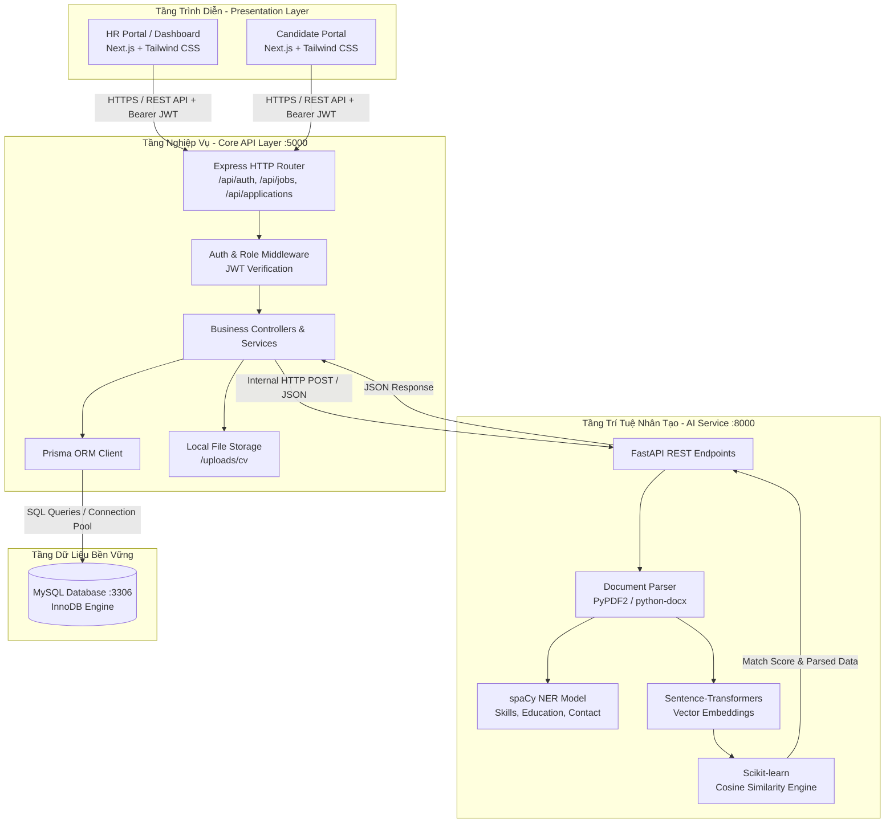
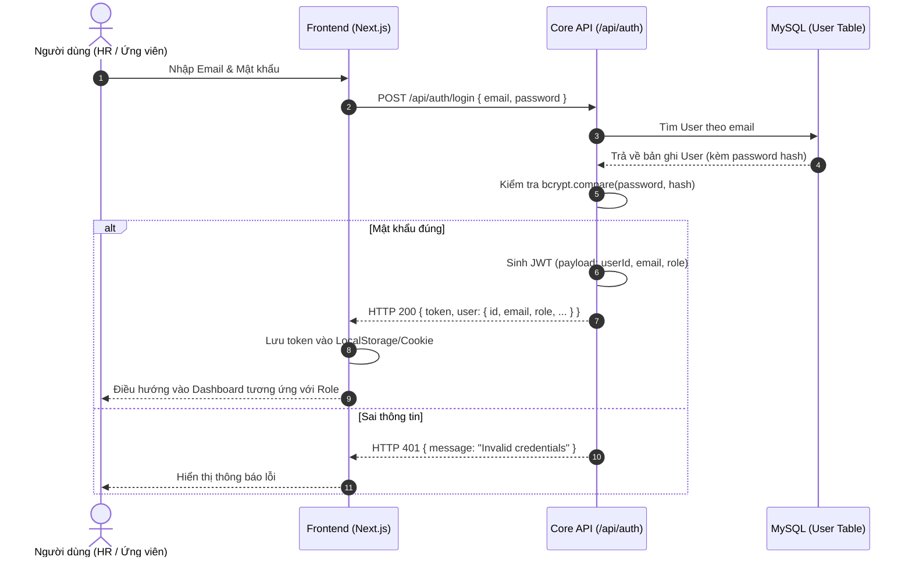
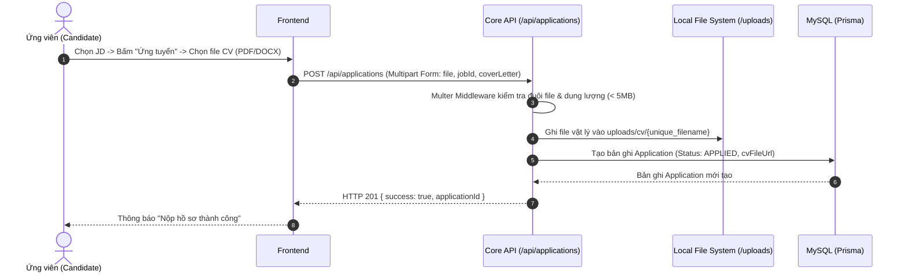
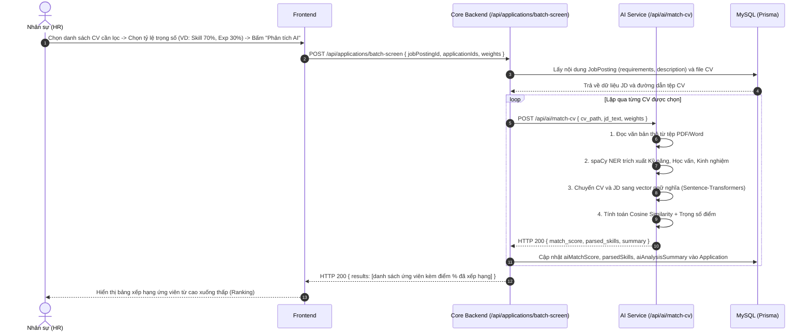
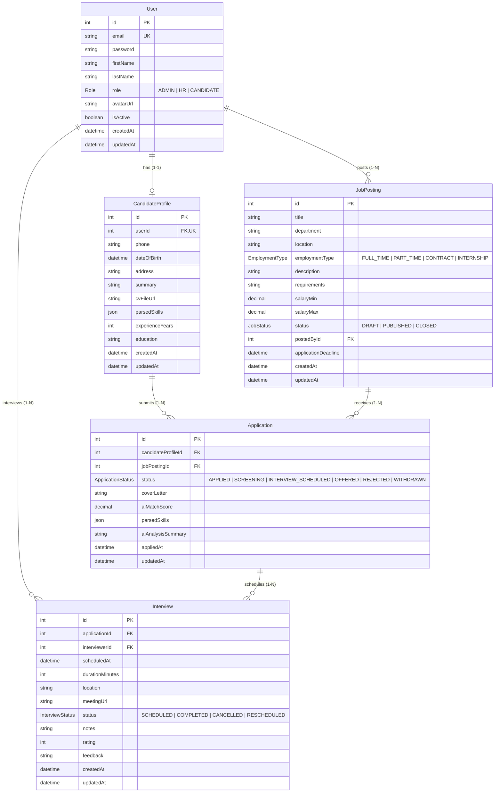

# TÀI LIỆU KIẾN TRÚC HỆ THỐNG (SYSTEM ARCHITECTURE)

---

## 1. TỔNG QUAN KIẾN TRÚC HỆ THỐNG

Hệ thống được thiết kế theo mô hình **Kiến trúc dịch vụ phân tách (Decoupled Services Architecture)** gồm 3 tầng thành phần chính:
1. **Frontend Presentation Layer**: Web App Next.js chịu trách nhiệm hiển thị giao diện người dùng, điều hướng trang (App Router) và gọi API.
2. **Core API Backend Layer**: Node.js/Express.js đóng vai trò trung tâm điều phối nghiệp vụ (Orchestrator), quản lý dữ liệu bền vững (MySQL qua Prisma ORM), xác thực JWT và xử lý lưu trữ tệp.
3. **AI Microservice Layer**: Python/FastAPI là service tính toán chuyên biệt (Stateless Compute Service) thực hiện bóc tách thực thể tự nhiên (NER) và đo độ tương đồng ngữ nghĩa giữa CV và JD.

---

## 2. CHI TIẾT CÁC TẦNG THÀNH PHẦN (SYSTEM LAYERS)

### 2.1. Presentation Layer (Frontend)
- **Công nghệ**: Next.js 16 (React 19), TypeScript, Tailwind CSS v4.
- **Port mặc định**: `3000`.
- **Cấu trúc phân hệ**:
  - `Candidate Portal`: Khách vãng lai và ứng viên xem tin tuyển dụng, tạo hồ sơ, tải lên CV và theo dõi trạng thái ứng tuyển.
  - `HR Management Portal`: Nhà tuyển dụng tạo tin, xem danh sách ứng viên nộp hồ sơ, kích hoạt chạy AI lọc ứng viên, chấm điểm và lên lịch phỏng vấn.
  - `Admin Dashboard`: Quản lý tài khoản và phân quyền hệ thống.
- **Giao tiếp**: Thư viện Axios / Fetch API được cấu hình trong `src/lib/api-client.ts`, gắn kèm Bearer Token trong Header `Authorization`.

### 2.2. Core Backend Layer (Express Core API)
- **Công nghệ**: Node.js, Express.js 5.x, TypeScript, Prisma ORM.
- **Port mặc định**: `5000`.
- **Vai trò**:
  - Xác thực người dùng (Authentication) và phân quyền dựa trên Role (`ADMIN`, `HR`, `CANDIDATE`).
  - Quản lý toàn bộ chu trình sống của dữ liệu (CRUD JobPosting, Application, Interview, User).
  - Tiếp nhận tệp tin CV từ ứng viên thông qua middleware Multer, lưu tệp an toàn vào hệ thống thư mục cục bộ `uploads/cv/`.
  - Gọi HTTP Request nội bộ sang AI Service để yêu cầu bóc tách và sàng lọc CV, sau đó lưu kết quả tính toán vào MySQL.

### 2.3. AI Microservice Layer (FastAPI AI Service)
- **Công nghệ**: Python 3.10+, FastAPI, Uvicorn.
- **Port mặc định**: `8000`.
- **Vai trò**:
  - Trích xuất văn bản thô từ tệp định dạng PDF và DOCX.
  - Thực hiện Named Entity Recognition (NER) bằng thư viện `spaCy` để nhận dạng các nhóm thực thể: Kỹ năng chuyên môn (Skills), Trình độ học vấn (Education), Thông tin liên hệ (Email, SĐT).
  - Sử dụng mô hình `sentence-transformers` (ví dụ: `all-MiniLM-L6-v2`) để chuyển đổi nội dung JD và CV thành các vector ngữ nghĩa đa chiều.
  - Áp dụng công thức Cosine Similarity từ `scikit-learn` kết hợp với trọng số tùy chỉnh (Kỹ năng vs Kinh nghiệm) để tính điểm phù hợp từ 0% đến 100%.

### 2.4. Data Storage Layer
- **Công nghệ**: MySQL Server (XAMPP hoặc Standalone), cổng kết nối `3306`.
- **Quản lý Schema**: Prisma ORM Client (`@prisma/client`), cơ chế migration tự động `prisma migrate`.

---

## 3. CÁC LUỒNG DỮ LIỆU CHÍNH (DATA FLOWS)

### 3.1. Luồng Xác thực & Phân quyền (Authentication & Authorization Flow)

### 3.2. Luồng Nộp Hồ sơ CV & Xử lý tệp (Candidate Application & CV Upload Flow)

### 3.3. Luồng Sàng lọc & Chấm điểm CV bằng AI (AI Screening Pipeline Flow)

---

## 4. THIẾT KẾ DỮ LIỆU & ĐỐI CHIẾU THỰC TẾ (DATABASE ARCHITECTURE & MAPPING)

### 4.1. Thực trạng Schema Prisma hiện hữu (`schema.prisma`)
Cơ sở dữ liệu của dự án được chuẩn hóa bằng Prisma ORM gồm các Entity cốt lõi sau:

### 4.2. Bảng Đối Chiếu: Biểu đồ Lớp Báo Cáo (Chương 3) vs Database Schema Thực Tế

| Lớp trong Báo cáo (Chương 3) | Model tương ứng trong Prisma Schema | Đánh giá mức độ tương thích & Giải pháp kiến trúc |
|---|---|---|
| **User** (`id`, `mail`, `password`, `userName`, `role`, `trangThai`) | **User** (`id`, `email`, `password`, `firstName`, `lastName`, `role`, `isActive`) | **Hoàn toàn tương thích**: Thuộc tính tương đồng 100%, chỉ khác biệt về ngôn ngữ (Anh - Việt). |
| **Hr** (`idHr`, `idUser`, `idCongTy`, `hoTen`, `soDienThoai`, `phongBan`) | **User** (role: `HR`) & **JobPosting** (`department`, `postedById`) | **Tương thích nghiệp vụ**: Prisma quản lý HR thông qua `User.role = HR`. Thông tin phòng ban được gắn trực tiếp vào từng tin tuyển dụng. |
| **UngVien** (`idUngVien`, `idUser`, `hoTen`, `soDienThoai`, `ngaySinh`, `gioiTinh`) | **CandidateProfile** (`id`, `userId`, `phone`, `dateOfBirth`, `address`) | **Hoàn toàn tương thích**: Gắn kết 1-1 với `User` có `role = CANDIDATE`. |
| **TinTuyenDung** (`idTin`, `idHr`, `idNganh`, `tieuDe`, `viTri`, `mucLuong`, `hanNop`) | **JobPosting** (`id`, `postedById`, `title`, `department`, `salaryMin`, `salaryMax`, `applicationDeadline`) | **Hoàn toàn tương thích**: Đáp ứng trọn vẹn thông tin chiến dịch tuyển dụng. |
| **HoSoCv** (`idCv`, `idUngVien`, `tieuDeCv`, `fileCv`, `ngayTao`, `trangThai`) | **CandidateProfile.cvFileUrl** & **Application** (tệp CV theo từng đơn ứng tuyển) | **Tương thích**: Trong schema thực tế, mỗi lần nộp đơn ứng tuyển, tệp CV được gắn kết trực tiếp với bản ghi `Application` hoặc hồ sơ mặc định của ứng viên. |
| **UngTuyen** (`idUngTuyen`, `idTin`, `idCv`, `ngayNop`, `trangThai`, `ghiChu`) | **Application** (`id`, `jobPostingId`, `candidateProfileId`, `appliedAt`, `status`, `coverLetter`) | **Tương thích nâng cao**: Schema Prisma bổ sung sẵn các trường AI (`aiMatchScore`, `parsedSkills`, `aiAnalysisSummary`) mà biểu đồ lớp báo cáo chưa có. |
| **LichPhongVan** (`idLich`, `idUngTuyen`, `thoiGian`, `diaDiem`, `hinhThuc`, `ketQua`) | **Interview** (`id`, `applicationId`, `scheduledAt`, `location`, `meetingUrl`, `status`, `rating`, `feedback`) | **Hoàn toàn tương thích**: Hỗ trợ đầy đủ phỏng vấn trực tiếp (`location`) và trực tuyến (`meetingUrl`), ghi nhận đánh giá và kết quả. |
| **ThongBao** (`idThongBao`, `idUser`, `tieuDe`, `noiDung`, `ngayTao`, `trangThai`) | *Chưa có bảng độc lập trong Prisma* | **Giải pháp kiến trúc**: Thông báo ứng viên được tổng hợp động từ trạng thái của `Application` và `Interview` (Notification polling / Virtual notification feed). |
| **CongTy** (`idCongTy`, `tenCongTy`, `diaChi`, `maSoThue`, `moTa`, `logo`) | *Chưa có bảng độc lập trong Prisma* | **Giải pháp kiến trúc**: Hệ thống ATS này phục vụ nội bộ một doanh nghiệp cụ thể (In-house ATS) nên thông tin công ty được quản trị ở cấp cấu hình hệ thống (System Settings / Brand config). |
| **NganhNghe** (`idNganh`, `tenNganh`, `moTa`) | **JobPosting.department** | **Tương thích nghiệp vụ**: Thay vì bảng quan hệ phụ, phân loại ngành nghề được lưu dưới dạng trường `department` trong bản tin tuyển dụng. |

---

## 5. GIAO THỨC TRUYỀN THÔNG & API SPECIFICATION

### 5.1. Giữa Client và Core Backend (Port 3000 -> Port 5000)
- **Giao thức**: HTTP/1.1 RESTful API over JSON.
- **Bảo mật**: Bearer JWT Token đặt trong Header `Authorization: Bearer <token>`.
- **Định dạng dữ liệu**: `Content-Type: application/json` hoặc `multipart/form-data` đối với các API upload tệp CV.

### 5.2. Giữa Core Backend và AI Service (Port 5000 -> Port 8000)
- **Giao thức**: HTTP REST (Internal Service-to-Service communication).
- **Endpoint cốt lõi**:
  - `POST /api/ai/parse-cv`: Nhận đường dẫn tệp CV hoặc file nhị phân -> Trả về JSON bóc tách thông tin (họ tên, kỹ năng, học vấn, năm kinh nghiệm).
  - `POST /api/ai/match-cv`: Nhận văn bản JD và CV -> Trả về điểm tương đồng Cosine Similarity và tóm tắt đánh giá.
  - `POST /api/ai/batch-screen`: Nhận danh sách CV và thông tin JD kèm trọng số -> Trả về danh sách xếp hạng ứng viên.
