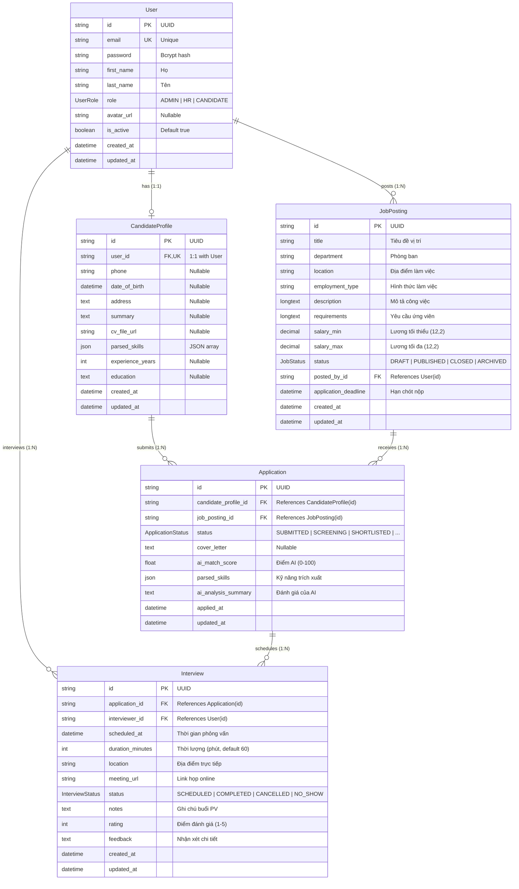

# TÀI LIỆU THIẾT KẾ CƠ SỞ DỮ LIỆU (DATABASE SCHEMA SPECIFICATION)

---

## 1. TỔNG QUAN HỆ CƠ SỞ DỮ LIỆU

Hệ thống Quản lý Tuyển dụng Tích hợp Trí tuệ Nhân tạo (ATS) sử dụng cơ sở dữ liệu quan hệ **MySQL** (phiên bản 8.0+ hoặc MariaDB 10.4+ trong XAMPP), được quản lý thông qua **Prisma ORM** (`@prisma/client` và `prisma CLI`).

- **Hệ quản trị CSDL**: MySQL / MariaDB (Storage Engine: `InnoDB`, Collation: `utf8mb4_unicode_ci`).
- **ORM / Schema Definition**: Prisma Schema (`backend/core-api/prisma/schema.prisma`).
- **Quy tắc đặt tên**:
  - Model (Prisma entity): `PascalCase` (ví dụ: `User`, `CandidateProfile`, `JobPosting`).
  - Table name (Database physical table): `snake_case` số nhiều (ví dụ: `users`, `candidate_profiles`, `job_postings`).
  - Column name: `snake_case` qua chỉ thị `@map("column_name")` (ví dụ: `first_name`, `created_at`).
  - Khóa chính (Primary Key): `id String @id @default(uuid())` kiểu UUID v4 để đảm bảo tính an toàn dữ liệu, chống suy đoán ID.

---

## 2. BIỂU ĐỒ THỰC THỂ QUAN HỆ HIỆN TẠI (CURRENT ERD)

Dưới đây là biểu đồ thực thể quan hệ phản ánh chính xác cấu trúc CSDL hiện tại trong `schema.prisma`:



---

## 3. CHI TIẾT CÁC BẢNG CƠ SỞ DỮ LIỆU HIỆN TẠI

### 3.1. Bảng `users` (Quản lý người dùng hệ thống)
Lưu trữ thông tin tài khoản người dùng, phân định vai trò giữa Admin, HR và Ứng viên.

| Tên cột | Kiểu dữ liệu | Ràng buộc | Mô tả |
|---|---|---|---|
| `id` | `VARCHAR(36)` | `PRIMARY KEY` | Khóa chính, UUID v4 sinh tự động |
| `email` | `VARCHAR(191)` | `UNIQUE`, `NOT NULL` | Email định danh người dùng dùng để đăng nhập |
| `password` | `VARCHAR(191)` | `NOT NULL` | Mật khẩu đã được băm bằng thuật toán `bcrypt` |
| `first_name` | `VARCHAR(191)` | `NOT NULL` | Họ và tên đệm |
| `last_name` | `VARCHAR(191)` | `NOT NULL` | Tên người dùng |
| `role` | `ENUM` | `DEFAULT 'CANDIDATE'` | Vai trò: `'ADMIN'`, `'HR'`, `'CANDIDATE'` |
| `avatar_url` | `VARCHAR(191)` | `NULL` | Đường dẫn ảnh đại diện người dùng |
| `is_active` | `BOOLEAN` | `DEFAULT TRUE` | Trạng thái kích hoạt tài khoản |
| `created_at` | `DATETIME(3)` | `DEFAULT CURRENT_TIMESTAMP(3)` | Thời điểm tạo tài khoản |
| `updated_at` | `DATETIME(3)` | `ON UPDATE CURRENT_TIMESTAMP(3)` | Thời điểm cập nhật gần nhất |

**Ràng buộc & Chỉ mục:**
- `UNIQUE INDEX` trên cột `email`.

---

### 3.2. Bảng `candidate_profiles` (Hồ sơ ứng viên mở rộng)
Lưu thông tin chuyên môn, học vấn, kinh nghiệm và kỹ năng trích xuất của người dùng có vai trò `CANDIDATE`.

| Tên cột | Kiểu dữ liệu | Ràng buộc | Mô tả |
|---|---|---|---|
| `id` | `VARCHAR(36)` | `PRIMARY KEY` | Khóa chính UUID v4 |
| `user_id` | `VARCHAR(36)` | `UNIQUE`, `FOREIGN KEY` | Khóa ngoại tham chiếu `users(id)`, `ON DELETE CASCADE` |
| `phone` | `VARCHAR(191)` | `NULL` | Số điện thoại liên hệ |
| `date_of_birth`| `DATETIME(3)` | `NULL` | Ngày tháng năm sinh |
| `address` | `TEXT` | `NULL` | Địa chỉ cư trú |
| `summary` | `TEXT` | `NULL` | Giới thiệu bản thân / Mục tiêu nghề nghiệp |
| `cv_file_url` | `VARCHAR(191)` | `NULL` | Đường dẫn tệp CV mặc định của ứng viên |
| `parsed_skills`| `JSON` | `NULL` | Mảng JSON các kỹ năng chuyên môn được AI trích xuất |
| `experience_years`| `INT` | `NULL` | Số năm kinh nghiệm làm việc |
| `education` | `TEXT` | `NULL` | Trình độ học vấn và cơ sở đào tạo |
| `created_at` | `DATETIME(3)` | `DEFAULT CURRENT_TIMESTAMP(3)` | Thời điểm tạo hồ sơ |
| `updated_at` | `DATETIME(3)` | `ON UPDATE CURRENT_TIMESTAMP(3)` | Thời điểm cập nhật |

**Quan hệ:**
- `user_id` liên kết 1-1 chặt chẽ với `users.id`. Khi tài khoản User bị xóa, profile tự động bị xóa theo (`CASCADE`).

---

### 3.3. Bảng `job_postings` (Tin tuyển dụng)
Lưu trữ thông tin chi tiết các chiến dịch tuyển dụng do nhân sự (HR) khởi tạo.

| Tên cột | Kiểu dữ liệu | Ràng buộc | Mô tả |
|---|---|---|---|
| `id` | `VARCHAR(36)` | `PRIMARY KEY` | Khóa chính UUID v4 |
| `title` | `VARCHAR(191)` | `NOT NULL` | Tiêu đề tin tuyển dụng (Ví dụ: Senior React Developer) |
| `department` | `VARCHAR(191)` | `NULL` | Phòng ban / Bộ phận tuyển dụng (Kỹ thuật, Marketing, ...) |
| `location` | `VARCHAR(191)` | `NULL` | Địa điểm làm việc (Hà Nội, TP.HCM, Remote) |
| `employment_type` | `VARCHAR(191)` | `NULL` | Hình thức làm việc (Full-time, Part-time, Internship) |
| `description` | `LONGTEXT` | `NOT NULL` | Mô tả trách nhiệm công việc chi tiết |
| `requirements` | `LONGTEXT` | `NULL` | Yêu cầu năng lực, kỹ năng, kinh nghiệm đối với ứng viên |
| `salary_min` | `DECIMAL(12, 2)` | `NULL` | Mức lương tối thiểu (VNĐ hoặc USD) |
| `salary_max` | `DECIMAL(12, 2)` | `NULL` | Mức lương tối đa |
| `status` | `ENUM` | `DEFAULT 'DRAFT'` | Trạng thái: `'DRAFT'`, `'PUBLISHED'`, `'CLOSED'`, `'ARCHIVED'` |
| `posted_by_id` | `VARCHAR(36)` | `FOREIGN KEY`, `NOT NULL` | Khóa ngoại tham chiếu `users(id)` của HR tạo tin |
| `application_deadline` | `DATETIME(3)` | `NULL` | Hạn chót nhận hồ sơ ứng tuyển |
| `created_at` | `DATETIME(3)` | `DEFAULT CURRENT_TIMESTAMP(3)` | Thời điểm tạo tin |
| `updated_at` | `DATETIME(3)` | `ON UPDATE CURRENT_TIMESTAMP(3)` | Thời điểm sửa đổi tin |

**Chỉ mục:**
- `INDEX` trên cột `status` (tối ưu truy vấn danh sách tin đang mở).
- `INDEX` trên cột `posted_by_id` (tối ưu truy vấn tin theo HR).

---

### 3.4. Bảng `applications` (Đơn ứng tuyển & Kết quả phân tích AI)
Ghi nhận mỗi lượt ứng tuyển của ứng viên vào một tin tuyển dụng cụ thể, đồng thời lưu giữ điểm số và kết quả phân tích NLP của AI.

| Tên cột | Kiểu dữ liệu | Ràng buộc | Mô tả |
|---|---|---|---|
| `id` | `VARCHAR(36)` | `PRIMARY KEY` | Khóa chính UUID v4 |
| `candidate_profile_id` | `VARCHAR(36)` | `FOREIGN KEY`, `NOT NULL` | Khóa ngoại tham chiếu `candidate_profiles(id)` |
| `job_posting_id` | `VARCHAR(36)` | `FOREIGN KEY`, `NOT NULL` | Khóa ngoại tham chiếu `job_postings(id)` |
| `status` | `ENUM` | `DEFAULT 'SUBMITTED'` | Trạng thái tuyển dụng của hồ sơ |
| `cover_letter` | `TEXT` | `NULL` | Thư giới thiệu của ứng viên |
| `ai_match_score` | `FLOAT` | `NULL` | Điểm số tương đồng AI tính toán (thang 0.0 - 100.0) |
| `parsed_skills` | `JSON` | `NULL` | Danh sách kỹ năng AI bóc tách được từ CV này |
| `ai_analysis_summary` | `TEXT` | `NULL` | Nhận xét phân tích điểm mạnh / điểm thiếu của AI |
| `applied_at` | `DATETIME(3)` | `DEFAULT CURRENT_TIMESTAMP(3)` | Thời điểm nộp đơn |
| `updated_at` | `DATETIME(3)` | `ON UPDATE CURRENT_TIMESTAMP(3)` | Thời điểm cập nhật trạng thái |

**Ràng buộc & Chỉ mục:**
- `UNIQUE INDEX` trên cặp `(candidate_profile_id, job_posting_id)`: Một ứng viên chỉ được nộp 1 đơn vào 1 tin tuyển dụng.
- `INDEX` trên cột `status` (lọc hồ sơ theo vòng tuyển dụng).
- `INDEX` trên cột `ai_match_score` (sắp xếp bảng xếp hạng ứng viên giảm dần theo điểm AI).

---

### 3.5. Bảng `interviews` (Lịch phỏng vấn & Đánh giá)
Quản lý lịch phỏng vấn giữa hội đồng phỏng vấn (HR / Admin) và ứng viên đã qua vòng lọc hồ sơ.

| Tên cột | Kiểu dữ liệu | Ràng buộc | Mô tả |
|---|---|---|---|
| `id` | `VARCHAR(36)` | `PRIMARY KEY` | Khóa chính UUID v4 |
| `application_id` | `VARCHAR(36)` | `FOREIGN KEY`, `NOT NULL` | Khóa ngoại tham chiếu `applications(id)` |
| `interviewer_id` | `VARCHAR(36)` | `FOREIGN KEY`, `NOT NULL` | Khóa ngoại tham chiếu `users(id)` của người phỏng vấn |
| `scheduled_at` | `DATETIME(3)` | `NOT NULL` | Ngày giờ diễn ra buổi phỏng vấn |
| `duration_minutes` | `INT` | `DEFAULT 60` | Thời lượng dự kiến (phút) |
| `location` | `VARCHAR(191)` | `NULL` | Địa chỉ phòng họp trực tiếp (nếu phỏng vấn offline) |
| `meeting_url` | `VARCHAR(191)` | `NULL` | Đường dẫn Google Meet / MS Teams / Zoom |
| `status` | `ENUM` | `DEFAULT 'SCHEDULED'` | Trạng thái: `'SCHEDULED'`, `'COMPLETED'`, `'CANCELLED'`, `'NO_SHOW'` |
| `notes` | `TEXT` | `NULL` | Ghi chú trước buổi phỏng vấn cho hội đồng |
| `rating` | `INT` | `NULL` | Điểm đánh giá phỏng vấn (1 đến 5 sao) |
| `feedback` | `TEXT` | `NULL` | Nhận xét chi tiết sau phỏng vấn |
| `created_at` | `DATETIME(3)` | `DEFAULT CURRENT_TIMESTAMP(3)` | Thời điểm lên lịch |
| `updated_at` | `DATETIME(3)` | `ON UPDATE CURRENT_TIMESTAMP(3)` | Thời điểm cập nhật kết quả |

**Chỉ mục:**
- `INDEX` trên cột `scheduled_at` (truy vấn lịch theo mốc thời gian).
- `INDEX` trên cột `application_id`.

---

## 4. ĐỐI CHIẾU 9 NGHIỆP VỤ GIỮA BÁO CÁO (CHƯƠNG 3) VÀ PRISMA SCHEMA

| Nghiệp vụ | Khảo sát trong Báo cáo Đồ án (Chương 3) | Hiện trạng trong Prisma Schema | Đánh giá & Khớp nối |
|---|---|---|---|
| **1. User** | Lớp `User` (id, email, password, vaiTro), lớp `Hr` và `Admin`. | Model `User` (`role: ADMIN, HR, CANDIDATE`). | **Khớp hoàn toàn**: Dùng Single Table Inheritance với cột `role` thay vì tách nhiều bảng người dùng rời rạc, tránh dư thừa dữ liệu. |
| **2. Job Posting** | Lớp `TinTuyenDung` liên kết với `CongTy` và `NganhNghe`. | Model `JobPosting` (`department`, `postedById`). | **Khớp nghiệp vụ**: Hệ thống đóng vai trò in-house ATS cho doanh nghiệp, `department` thay thế cho ngành nghề/công ty. |
| **3. Candidate Profile**| Lớp `UngVien` liên kết 1-n với `HoSoCv`. | Model `CandidateProfile` (`userId`, `cvFileUrl`, `parsedSkills`, `experienceYears`, `education`). | **Khớp**: Lưu hồ sơ cá nhân và kỹ năng của ứng viên. |
| **4. CV (Hồ sơ CV)** | Lớp `HoSoCv` riêng biệt, 1 ứng viên có nhiều CV. | `CandidateProfile.cvFileUrl`. Chưa có cột lưu file CV riêng cho từng đơn ứng tuyển `Application`. | ⚠️ **CẦN ĐIỀU CHỈNH**: Cần lưu `cvFileUrl` vào chính bản ghi `Application` để ứng viên có thể nộp các CV khác nhau cho từng vị trí. |
| **5. Application** | Lớp `UngTuyen` liên kết tin tuyển dụng và hồ sơ CV. | Model `Application` liên kết `CandidateProfile` và `JobPosting`. | **Khớp**: Ràng buộc duy nhất `@@unique([candidateProfileId, jobPostingId])` ngăn nộp trùng đơn. |
| **6. AI Analysis** | Use case UC05 tính điểm độ tương đồng, trích xuất NLP kỹ năng. | Lưu trực tiếp trong `Application`: `aiMatchScore`, `parsedSkills`, `aiAnalysisSummary`. | ⚠️ **CẦN BỔ SUNG TRƯỜNG**: Thiếu trường trạng thái tiến trình AI (`ai_status: PENDING/COMPLETED/FAILED`) và điểm chi tiết thành phần. |
| **7. Interview** | Lớp `LichPhongVan` (thoiGian, diaDiem, nguoiPhongVan, ketQua). | Model `Interview` (`applicationId`, `interviewerId`, `meetingUrl`, `rating`, `feedback`). | **Khớp hoàn toàn**: Rất đầy đủ các trường đánh giá và họp trực tuyến. |
| **8. Notification** | Lớp `ThongBao` (id, userId, noiDung, ngayGui, daDoc) - UC09. | ❌ **CHƯA CÓ TRONG SCHEMA**. | ⚠️ **BẢNG THIẾU**: Báo cáo có use case thông báo nhưng schema chưa có bảng `notifications`. |
| **9. Reporting** | Use case UC07: Báo cáo tỷ lệ CV, tỷ lệ đạt/trượt, thống kê tin. | Không cần bảng vật lý riêng. | **Khớp chuẩn**: Thống kê được tổng hợp động (Dynamic Aggregations) qua truy vấn SQL `COUNT`, `GROUP BY`, `AVG`. |

---

## 5. XÁC ĐỊNH BẢNG CÒN THIẾU VÀ QUAN HỆ CẦN ĐIỀU CHỈNH

### 5.1. Bảng còn thiếu: `notifications`
- **Nguyên nhân**: Báo cáo có Use case UC09 (Xem thông báo kết quả) và sơ đồ lớp Hình 3.21 có lớp `ThongBao`, nhưng `schema.prisma` chưa khai báo bảng này.
- **Phương án giải quyết trong giai đoạn hiện tại (CHƯA migrate)**:
  - Tầng API hợp đồng (`API_CONTRACT.md`) vẫn định nghĩa endpoint `GET /api/notifications` và `PATCH /api/notifications/:id/read`.
  - Backend tạm thời tổng hợp thông báo động (Virtual Feed) từ sự kiện thay đổi trạng thái trong `Application` và sự kiện tạo lịch trong `Interview`.
  - Đề xuất bổ sung model `Notification` vào Schema để thực hiện trong đợt migration tương lai (khi được User duyệt).

### 5.2. Quan hệ và trường dữ liệu cần điều chỉnh trong `Application`:
1. **Thiếu trường lưu tệp CV theo đơn (`cv_file_url`)**:
   - Hiện tại chỉ có `CandidateProfile.cvFileUrl`. Nếu ứng viên nộp CV cho Job A, sau đó 2 tháng ứng viên cập nhật CV mới để nộp Job B, thì hồ sơ Job A bị trỏ sai tệp CV ban đầu.
   - *Đề xuất*: Thêm trường `cv_file_url String? @map("cv_file_url")` vào model `Application`.
2. **Thiếu trường trạng thái phân tích AI (`ai_status`)**:
   - Quá trình phân tích NLP và embedding tốn từ 2 - 5 giây. Nếu chỉ dựa vào `aiMatchScore != null`, hệ thống không phân biệt được đơn đang phân tích (`PROCESSING`), đơn bị lỗi đọc file (`FAILED`), hay đơn chưa chạy (`PENDING`).
   - *Đề xuất*: Thêm enum `AIStatus { PENDING, PROCESSING, COMPLETED, FAILED }` và trường `aiStatus AIStatus @default(PENDING) @map("ai_status")` vào `Application`.
3. **Chi tiết điểm thành phần của AI**:
   - Để hiển thị giải trình minh bạch cho HR xem lý do đạt điểm (ví dụ: Kỹ năng 90%, Kinh nghiệm 70%, Ngữ nghĩa 85%), cần lưu trữ cấu trúc JSON chi tiết điểm thành phần vào `Application`.

---

## 6. ĐỀ XUẤT NÂNG CẤP PRISMA SCHEMA (DỰ THẢO - CHƯA MIGRATE)

Dưới đây là mã khai báo Prisma dự thảo để User xem xét và phê duyệt trước khi tiến hành migration ở giai đoạn sau:

```prisma
// ============================================================================
// ĐỀ XUẤT BỔ SUNG (DỰ THẢO CHO GIAI ĐOẠN MIGRATION SAU)
// ============================================================================

enum AIStatus {
  PENDING
  PROCESSING
  COMPLETED
  FAILED
}

enum NotificationType {
  APPLICATION_STATUS_CHANGED
  INTERVIEW_SCHEDULED
  INTERVIEW_CANCELLED
  SYSTEM_ALERT
}

// Bổ sung các trường vào Application hiện tại:
// model Application {
//   ...
//   cvFileUrl          String?           @map("cv_file_url")
//   aiStatus           AIStatus          @default(PENDING) @map("ai_status")
//   aiScoreDetails     Json?             @map("ai_score_details") // { skillsScore, expScore, semanticScore }
//   matchedSkills      Json?             @map("matched_skills")
//   missingSkills      Json?             @map("missing_skills")
//   ...
// }

// Bổ sung Model Notification mới:
model Notification {
  id        String           @id @default(uuid())
  userId    String           @map("user_id")
  title     String
  message   String           @db.Text
  type      NotificationType @default(SYSTEM_ALERT)
  isRead    Boolean          @default(false) @map("is_read")
  metadata  Json?            // Chứa { applicationId, interviewId, jobId }
  createdAt DateTime         @default(now()) @map("created_at")

  user      User             @relation(fields: [userId], references: [id], onDelete: Cascade)

  @@index([userId, isRead])
  @@map("notifications")
}
```

---

## 7. KẾT LUẬN & NGUYÊN TẮC THIẾT KẾ DỮ LIỆU

1. **Tuyệt đối không tạo bảng trùng lặp**: Không tạo thêm bảng `HoSoCv` riêng biệt vì sẽ gây trùng lặp với `CandidateProfile` và `Application`. Mỗi lượt nộp trong `Application` chính là một snapshot hồ sơ ứng tuyển độc lập.
2. **Đảm bảo tính toàn vẹn tham chiếu**: Mọi liên kết khóa ngoại đều thiết lập `onDelete: Cascade` từ bảng cha (User -> CandidateProfile, User -> JobPosting) để tránh mồ côi dữ liệu khi dọn dẹp tài khoản.
3. **Tối ưu hóa chỉ mục (Indexes)**: Các cột thường xuyên truy vấn lọc như `Application.status`, `JobPosting.status`, `Application.aiMatchScore`, `Interview.scheduledAt` đều đã được đánh chỉ mục.
