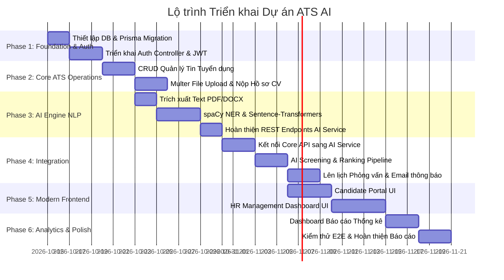

# KẾ HOẠCH TRIỂN KHAI KỸ THUẬT (IMPLEMENTATION PLAN)

---

## 1. NGUYÊN TẮC VÀ CHIẾN LƯỢC TRIỂN KHAI

Kế hoạch này được xây dựng dựa trên nguyên tắc **Phát triển theo phân kỳ (Phased Rollout)**, đảm bảo tính chặt chẽ, dễ kiểm soát và không gây xung đột kiến trúc:
- **Nguyên tắc bất biến**: Không thay đổi bộ khung công nghệ, không phá vỡ schema CSDL hiện có trong `schema.prisma`, tách bạch trách nhiệm giữa 3 phân hệ (Frontend - Core API - AI Service).
- **Trình tự ưu tiên**: Xây dựng nền tảng dữ liệu và dịch vụ lõi (Core Backend) -> Hoàn thiện thuật toán AI (AI Service) -> Tích hợp liên dịch vụ -> Hoàn thiện giao diện người dùng (Frontend) -> Kiểm thử và báo cáo.

---

## 2. LỘ TRÌNH CHI TIẾT THEO TỪNG GIAI ĐOẠN

### GIAI ĐOẠN 1: NỀN TẢNG DỮ LIỆU & XÁC THỰC (FOUNDATION & AUTHENTICATION)
**Mục tiêu**: Kích hoạt cơ sở dữ liệu MySQL và phân hệ xác thực phân quyền Role-based Access Control.

- **Nhiệm vụ 1.1**: Đồng bộ CSDL và Prisma Client:
  - Khởi tạo kết nối MySQL XAMPP qua chuỗi kết nối `DATABASE_URL` trong `.env`.
  - Thực thi lệnh `prisma db push` hoặc `prisma migrate dev` để tạo đầy đủ các bảng (`User`, `CandidateProfile`, `JobPosting`, `Application`, `Interview`).
  - Sinh mã `npx prisma generate` cho `@prisma/client`.
- **Nhiệm vụ 1.2**: Triển khai Module Xác thực (`src/controllers/auth.controller.ts` & `src/services/auth.service.ts`):
  - `POST /api/auth/register`: Đăng ký tài khoản (mã hóa mật khẩu bằng `bcryptjs`), tự động khởi tạo bản ghi `CandidateProfile` nếu role là `CANDIDATE`.
  - `POST /api/auth/login`: Xác thực thông tin đăng nhập, sinh JSON Web Token (JWT) chứa thông tin `userId`, `email`, `role`.
  - `GET /api/auth/me`: Lấy thông tin tài khoản hiện tại thông qua Access Token.
  - `PUT /api/auth/profile`: Cập nhật thông tin cá nhân (Họ tên, SĐT, ngày sinh, địa chỉ).
- **Nhiệm vụ 1.3**: Triển khai Middleware xác thực:
  - `auth.middleware.ts`: Xác thực Bearer Token từ Header request.
  - `role.middleware.ts`: Phân quyền người dùng theo vai trò (`HR`, `CANDIDATE`, `ADMIN`).
- **Tiêu chí nghiệm thu (Acceptance Criteria)**:
  - Kiểm thử Postman đăng ký và đăng nhập thành công cho cả 2 vai trò HR và Ứng viên.
  - Token JWT hợp lệ có thời hạn sống, các route bảo vệ từ chối truy cập nếu không có token hoặc sai quyền.

---

### GIAI ĐOẠN 2: QUẢN LÝ TIN TUYỂN DỤNG & TIẾP NHẬN HỒ SƠ ỨNG VIÊN
**Mục tiêu**: Hoàn thiện nghiệp vụ quản lý chiến dịch tuyển dụng và cơ chế tiếp nhận hồ sơ ứng tuyển kèm tệp CV.

- **Nhiệm vụ 2.1**: Triển khai Job Module (`src/controllers/jobs.controller.ts` & `src/services/job.service.ts`):
  - `GET /api/jobs`: Lấy danh sách tin tuyển dụng công khai (hỗ trợ phân trang, lọc theo phòng ban, mức lương, tìm kiếm từ khóa).
  - `GET /api/jobs/:id`: Xem chi tiết bản mô tả công việc (JD).
  - `POST /api/jobs` (Chỉ HR): Đăng tin tuyển dụng mới.
  - `PUT /api/jobs/:id` (Chỉ HR): Chỉnh sửa thông tin tin tuyển dụng.
  - `PATCH /api/jobs/:id/status` (Chỉ HR): Đóng hoặc mở lại chiến dịch tuyển dụng (`JobStatus: DRAFT | PUBLISHED | CLOSED`).
  - `DELETE /api/jobs/:id` (Chỉ HR): Xóa tin tuyển dụng.
- **Nhiệm vụ 2.2**: Cấu hình Upload tệp vật lý với Multer (`src/middlewares/upload.middleware.ts`):
  - Thiết lập thư mục lưu trữ cục bộ: `backend/core-api/uploads/cv/`.
  - Kiểm tra định dạng tệp: Chỉ cho phép tệp `.pdf`, `.doc`, `.docx`.
  - Giới hạn dung lượng: Tối đa 5MB (theo đúng ràng buộc tại Bảng 12 trong Báo cáo).
  - Đặt tên file ngẫu nhiên bảo mật (Timestamp + UUID) tránh trùng lặp hoặc ghi đè.
- **Nhiệm vụ 2.3**: Triển khai Application Module (`src/controllers/application.controller.ts` & `src/services/application.service.ts`):
  - `POST /api/applications` (Chỉ Ứng viên): Nộp hồ sơ ứng tuyển kèm upload file CV và thư giới thiệu (`coverLetter`). Trạng thái ban đầu: `APPLIED`.
  - `GET /api/applications/my-applications` (Chỉ Ứng viên): Tra cứu danh sách các chiến dịch đã nộp hồ sơ.
  - `PUT /api/applications/:id/withdraw` (Chỉ Ứng viên): Hủy nộp hồ sơ (`ApplicationStatus: WITHDRAWN`).
  - `GET /api/applications/job/:jobId` (Chỉ HR): Lấy danh sách toàn bộ hồ sơ nộp vào một chiến dịch cụ thể.
  - `PATCH /api/applications/:id/status` (Chỉ HR): Cập nhật trạng thái hồ sơ (Chuyển vòng: `SCREENING`, `INTERVIEW_SCHEDULED`, `OFFERED`, `REJECTED`).
- **Tiêu chí nghiệm thu**:
  - Ứng viên upload tệp PDF nộp thành công, file được lưu vào `uploads/cv/` và bản ghi CSDL được liên kết chính xác.
  - HR tra cứu được toàn bộ hồ sơ của chiến dịch tuyển dụng và tải được file CV về xem.

---

### GIAI ĐOẠN 3: HOÀN THIỆN PHÂN HỆ AI MICROSERVICE (NLP & MATCHING ENGINE)
**Mục tiêu**: Xây dựng thuật toán bóc tách thực thể CV và đo độ tương đồng ngữ nghĩa thực thụ bằng Python.

- **Nhiệm vụ 3.1**: Xây dựng module trích xuất văn bản từ tệp (`backend/ai-service/app/services/document_parser.py`):
  - Hỗ trợ đọc tệp PDF bằng thư viện `PyPDF2` / `pdfplumber`.
  - Hỗ trợ đọc tệp DOCX bằng thư viện `python-docx`.
  - Chuẩn hóa văn bản: Loại bỏ khoảng trắng thừa, ký tự đặc biệt, đưa về dạng chuỗi sạch (Clean text).
- **Nhiệm vụ 3.2**: Xây dựng module trích xuất thực thể bằng spaCy NER (`backend/ai-service/app/services/nlp.py`):
  - Trích xuất thông tin liên hệ (Email, Số điện thoại) bằng biểu thức chính quy Regex.
  - Trích xuất kỹ năng chuyên môn (Skills) bằng cơ chế đối sánh từ điển kỹ năng kết hợp với mô hình thực thể ngôn ngữ `spaCy` (`en_core_web_sm` / quy tắc tiếng Việt).
  - Trích xuất trình độ học vấn (Education) và số năm kinh nghiệm (Experience years).
- **Nhiệm vụ 3.3**: Xây dựng module đo độ tương đồng Cosine & Tính điểm trọng số:
  - Sử dụng mô hình `sentence-transformers` (`all-MiniLM-L6-v2`) để chuyển hóa toàn bộ nội dung CV và JD thành các vector đặc trưng 384 chiều.
  - Tính toán độ tương đồng góc Cosine bằng hàm `cosine_similarity` từ `scikit-learn`.
  - Tích hợp công thức tính điểm kết hợp trọng số:
    $$\text{MatchScore} = \left( w_{\text{skill}} \times \text{SkillMatch} + w_{\text{exp}} \times \text{ExpMatch} + w_{\text{sem}} \times \text{CosineSimilarity} \right) \times 100$$
    *(Mặc định: Kỹ năng 50%, Kinh nghiệm 20%, Độ tương đồng ngữ nghĩa 30%)*.
- **Nhiệm vụ 3.4**: Hoàn thiện REST Endpoints trong FastAPI (`app/api/endpoints.py`):
  - `POST /api/ai/parse-cv`: Bóc tách thông tin từ tệp CV.
  - `POST /api/ai/match-cv`: Chấm điểm 1 CV so với 1 JD kèm trọng số.
  - `POST /api/ai/batch-screen`: Sàng lọc hàng loạt danh sách CV cho 1 JD và trả về bảng xếp hạng (Ranking).
- **Tiêu chí nghiệm thu**:
  - API xử lý thành công tệp CV thực tế (PDF/Word), trích xuất chính xác danh sách kỹ năng và trả về điểm số từ 0 đến 100% kèm tóm tắt đánh giá có ý nghĩa.

---

### GIAI ĐOẠN 4: TÍCH HỢP LIÊN DỊCH VỤ & NGHIỆP VỤ ATS CHUYÊN SÂU
**Mục tiêu**: Nối thông toàn diện giữa Core API và AI Service, hoàn thiện quy trình phỏng vấn và gửi thông báo.

- **Nhiệm vụ 4.1**: Xây dựng AI Client Service trong Core API (`src/services/ai.service.ts`):
  - Tạo hàm gọi nội bộ sang AI Service (Port 8000) với cơ chế Timeout và Error Handling an toàn.
  - `POST /api/applications/batch-screen` (Chỉ HR): HR chọn chiến dịch và danh sách ứng viên -> Core API gọi sang AI Service -> Nhận kết quả -> Tự động lưu `aiMatchScore`, `parsedSkills`, `aiAnalysisSummary` vào từng bản ghi `Application` trong MySQL.
- **Nhiệm vụ 4.2**: Triển khai Module Phỏng vấn (`src/controllers/interview.controller.ts` & `src/services/interview.service.ts`):
  - `POST /api/interviews` (Chỉ HR): Đặt lịch phỏng vấn cho ứng viên đạt vòng sơ loại (Thời gian, địa điểm, link họp Google Meet/Zoom, ghi chú).
  - Tự động cập nhật `Application.status = INTERVIEW_SCHEDULED`.
  - `GET /api/interviews/application/:appId`: Lấy thông tin lịch phỏng vấn theo đơn ứng tuyển.
  - `PATCH /api/interviews/:id/result` (Chỉ HR): Ghi nhận đánh giá (`rating: 1-5`), nhận xét (`feedback`) và cập nhật kết quả phỏng vấn.
- **Nhiệm vụ 4.3**: Tích hợp luồng gửi email thông báo tự động (Nodemailer):
  - Gửi email mời phỏng vấn đến hòm thư của ứng viên khi HR tạo lịch phỏng vấn.
  - Gửi email thông báo kết quả (Trúng tuyển / Thư cảm ơn từ chối) khi HR cập nhật trạng thái tuyển dụng.
- **Tiêu chí nghiệm thu**:
  - Bấm một nút kích hoạt sàng lọc AI từ Core API, toàn bộ các ứng viên trong đợt tuyển dụng được chấm điểm và sắp xếp theo thứ tự ưu tiên trong cơ sở dữ liệu.

---

### GIAI ĐOẠN 5: XÂY DỰNG GIAO DIỆN NGƯỜI DÙNG HIỆN ĐẠI (FRONTEND)
**Mục tiêu**: Xây dựng giao diện web Next.js trực quan, thẩm mỹ cao (Dark/Light mode, animations, responsive), mang lại trải nghiệm tối ưu cho cả HR và Ứng viên.

- **Nhiệm vụ 5.1**: Thiết kế hệ thống UI Components & Theme:
  - Cấu hình font chữ Google Inter, bảng màu HSL hiện đại, Tailwind CSS v4.
  - Xây dựng bộ UI dùng chung: `Navbar`, `Sidebar`, `Button`, `Input`, `Modal`, `Badge`, `StatusPill`, `ProgressBar`.
- **Nhiệm vụ 5.2**: Xây dựng Phân hệ Ứng viên (Candidate Portal):
  - `Trang chủ (Landing Page)`: Banner tìm kiếm việc làm, danh sách việc làm nổi bật, giới thiệu tính năng AI ATS.
  - `Trang Tin Tuyển dụng (/jobs)`: Tìm kiếm, lọc theo phòng ban, mức lương; trang chi tiết JD kèm nút "Ứng tuyển ngay".
  - `Modal nộp hồ sơ`: Kéo thả tải lên file CV (PDF/DOCX), nhập thư giới thiệu, hiển thị thanh tiến trình tải lên.
  - `Trang Quản lý Ứng tuyển (/candidate/applications)`: Xem tiến độ hồ sơ qua từng giai đoạn (Đã nộp -> Sàng lọc -> Phỏng vấn -> Kết quả), xem lịch phỏng vấn và nút hủy đơn.
- **Nhiệm vụ 5.3**: Xây dựng Phân hệ Quản trị Tuyển dụng (HR Portal):
  - `HR Dashboard Tổng quan (/dashboard)`: Số lượng tin tuyển dụng, tổng số CV tiếp nhận, số lịch phỏng vấn trong tuần.
  - `Quản lý Tin Tuyển dụng (/dashboard/jobs)`: Bảng danh sách tin, modal thêm/sửa tin tuyển dụng với trình soạn thảo trực quan.
  - `Quản lý Hồ sơ CV (/dashboard/applications)`: Bảng danh sách ứng viên, bộ lọc theo trạng thái và theo chiến dịch.
  - `Màn hình Sàng lọc AI (/dashboard/ai-screening)`:
    - Thanh trượt điều chỉnh tỷ lệ trọng số tiêu chí (Kỹ năng vs Kinh nghiệm).
    - Nút bấm "Chạy phân tích AI" kèm hiệu ứng Loading chuyên nghiệp.
    - Bảng xếp hạng ứng viên (Ranking Table) hiển thị trực quan: Tỷ lệ % phù hợp, Kỹ năng khớp (màu xanh lá), Kỹ năng còn thiếu (màu đỏ), bản tóm tắt nhận xét của AI.
  - `Modal Lên lịch Phỏng vấn`: Chọn ngày giờ, nhập địa điểm/link họp, bấm xác nhận để tự động gửi thông báo.
- **Tiêu chí nghiệm thu**:
  - Giao diện phản hồi mượt mà, thân thiện trên cả máy tính và thiết bị di động, thao tác trực quan, không phát sinh lỗi Console.

---

### GIAI ĐOẠN 6: BÁO CÁO THỐNG KÊ, KIỂM THỬ E2E & BÀN GIAO ĐỒ ÁN
**Mục tiêu**: Cung cấp báo cáo phân tích hiệu suất tuyển dụng, kiểm thử toàn bộ luồng nghiệp vụ và chuẩn bị hồ sơ nghiệm thu.

- **Nhiệm vụ 6.1**: Triển khai Module Báo cáo Thống kê (Analytics):
  - API `GET /api/analytics/overview`: Tổng hợp số lượng CV nộp theo thời gian, tỷ lệ chuyển đổi qua các vòng (Phễu tuyển dụng: Ứng tuyển -> Sàng lọc -> Phỏng vấn -> Trúng tuyển).
  - Giao diện biểu đồ trực quan phía HR Dashboard (sử dụng Recharts hoặc Chart.js).
  - Chức năng xuất dữ liệu báo cáo ra file Excel (`xlsx`).
- **Nhiệm vụ 6.2**: Kiểm thử toàn diện đầu-cuối (End-to-End Testing):
  - Kịch bản 1: Luồng hoàn chỉnh từ Đăng tin -> Ứng viên nộp CV -> AI sàng lọc xếp hạng -> HR lên lịch phỏng vấn -> Gửi email -> Cập nhật trúng tuyển.
  - Kịch bản 2: Kiểm thử xử lý lỗi ngoại lệ (File CV sai định dạng, file hỏng, AI service gián đoạn kết nối, nhập sai mật khẩu).
- **Nhiệm vụ 6.3**: Hoàn thiện Hồ sơ Đồ án:
  - Cập nhật mục 3.2.8 "Thiết kế cơ sở dữ liệu vật lý" vào file báo cáo Word dựa trên cấu trúc `schema.prisma`.
  - Viết tài liệu hướng dẫn triển khai và cài đặt hệ thống (`DEPLOYMENT.md`).
- **Tiêu chí nghiệm thu**:
  - Hệ thống vận hành ổn định trên môi trường máy chủ cục bộ (Localhost).
  - Đáp ứng trọn vẹn 100% các Use Case đã cam kết trong Báo cáo Đồ án tốt nghiệp.
