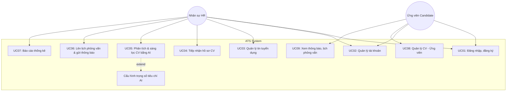
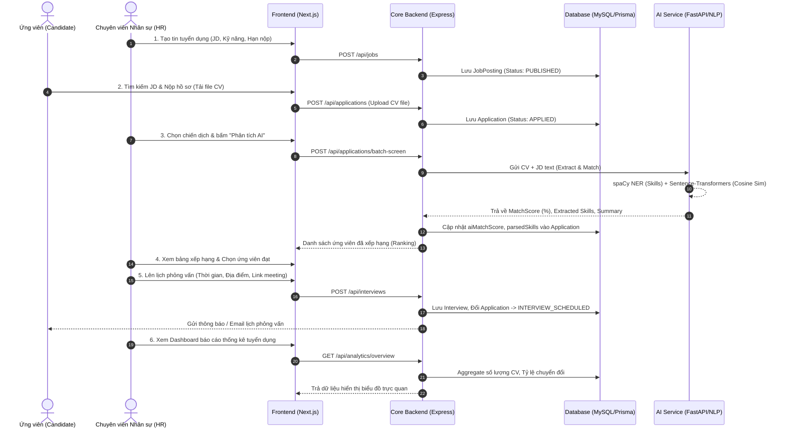

# TÀI LIỆU BỐI CẢNH DỰ ÁN (PROJECT CONTEXT)

---

## 1. THÔNG TIN CHUNG ĐỀ TÀI

- **Tên đề tài**: **XÂY DỰNG HỆ THỐNG QUẢN LÝ TUYỂN DỤNG TÍCH HỢP TRÍ TUỆ NHÂN TẠO HỖ TRỢ PHÂN TÍCH VÀ SÀNG LỌC CV**
- **Loại hình**: Đồ án tốt nghiệp / Đồ án chuyên ngành Công nghệ thông tin
- **Đơn vị đào tạo**: Khoa Công nghệ Thông tin – Trường Đại học Công nghệ Giao thông Vận tải (UTT)
- **Lớp**: 74DCTT24
- **Chuyên ngành**: Công nghệ thông tin
- **Giảng viên hướng dẫn**: ThS. Lê Trung Kiên
- **Nhóm sinh viên thực hiện (Nhóm 7)**:
  1. Nguyễn Trường Giang
  2. Nguyễn Xuân Bách
  3. Nguyễn Quốc Anh
  4. Trần Hữu Mạnh
  5. Kiều Trung Kiên

---

## 2. BỐI CẢNH VÀ ĐỘNG LỰC DỰ ÁN

### 2.1. Thực trạng tuyển dụng hiện nay
Dựa trên kết quả khảo sát thực tế được ghi nhận trong báo cáo phân tích nghiệp vụ (Khảo sát HR Manager và Chuyên viên tuyển dụng tại doanh nghiệp):
1. **Quá tải hồ sơ ứng tuyển**: Trung bình mỗi chiến dịch tuyển dụng vị trí CNTT tiếp nhận từ 200 – 500 CV thông qua nhiều kênh phân tán (Email, TopCV, VietnamWorks, LinkedIn, Facebook).
2. **Quy trình xử lý thủ công**: HR phải tải từng tệp CV (PDF/Word), phân loại thư mục thủ công, sau đó nhập liệu tóm tắt vào bảng tính Excel. Quá trình này tiêu tốn trung bình 60% – 70% tổng thời gian tuyển dụng.
3. **Rủi ro bỏ sót và đánh giá cảm tính**: Việc đọc lướt hàng trăm CV trong thời gian ngắn dễ dẫn đến mệt mỏi, bỏ sót ứng viên tiềm năng hoặc đánh giá không nhất quán với Bản mô tả công việc (Job Description - JD).
4. **Trải nghiệm ứng viên chưa tối ưu**: Do khối lượng công việc quá tải, bộ phận nhân sự thường chậm trễ hoặc không thể phản hồi kết quả cho ứng viên bị từ chối, gây ảnh hưởng tiêu cực đến thương hiệu tuyển dụng (Employer Branding).
5. **Khó khăn trong tái sử dụng dữ liệu**: Hồ sơ cũ lưu rải rác trên file Excel hoặc hòm thư, không có công cụ tìm kiếm ngữ nghĩa hay kỹ năng tập trung để kích hoạt lại ứng viên tiềm năng trong các đợt tuyển dụng sau.

### 2.2. Mục tiêu của hệ thống
Hệ thống Quản lý Tuyển dụng Tích hợp AI (AI-Powered Applicant Tracking System - ATS) được xây dựng nhằm:
- **Tập trung hóa quy trình tuyển dụng**: Xây dựng nền tảng web thống nhất cho phép doanh nghiệp đăng tải tin tuyển dụng, tiếp nhận CV trực tuyến, quản lý trạng thái hồ sơ và lên lịch phỏng vấn.
- **Tích hợp Trí tuệ Nhân tạo (AI/NLP)**:
  - Tự động bóc tách thông tin có cấu trúc từ CV (Họ tên, Email, Số điện thoại, Kỹ năng chuyên môn, Học vấn, Kinh nghiệm).
  - Ứng dụng kỹ thuật nhúng ngữ nghĩa (Sentence Transformers) và độ đo tương đồng Cosine (Cosine Similarity) để tính điểm phù hợp giữa CV và JD.
  - Tự động xếp hạng (Ranking) ứng viên theo tỷ lệ % phù hợp, cho phép HR lọc nhanh top ứng viên sáng giá nhất.
- **Nâng cao năng suất và hiệu quả**: Giảm 70% thời gian sàng lọc ban đầu, hỗ trợ gửi phản hồi tự động, cung cấp bảng điều khiển báo cáo trực quan (Dashboard & Analytics) giúp tối ưu hóa chiến dịch tuyển dụng.

---

## 3. PHẠM VI VÀ CÁC TÁC NHÂN HỆ THỐNG

### 3.1. Các tác nhân chính (Actors)

| Tác nhân | Mô tả vai trò |
|---|---|
| **Nhân sự (HR / Recruiter)** | Người sử dụng hệ thống phía doanh nghiệp: Đăng tin tuyển dụng, xem danh sách CV, cấu hình trọng số tiêu chí AI, kích hoạt sàng lọc CV tự động, cập nhật trạng thái hồ sơ, lên lịch phỏng vấn và theo dõi báo cáo thống kê tuyển dụng. |
| **Ứng viên (Candidate)** | Người tìm kiếm cơ hội việc làm: Xem danh sách và chi tiết tin tuyển dụng, nộp hồ sơ CV (PDF/DOCX), theo dõi trạng thái hồ sơ ứng tuyển, nhận lịch hẹn phỏng vấn và thông báo kết quả. |
| **Quản trị viên (Admin)** | Quản lý người dùng, phân quyền hệ thống và giám sát hoạt động chung. *(Theo schema thiết kế, Admin kế thừa và quản lý phạm vi rộng hơn HR)*. |

### 3.2. Danh sách Use Case nghiệp vụ (Theo Chương 3 Báo cáo)

---

## 4. QUY TRÌNH NGHIỆP VỤ CỐT LÕI (CORE BUSINESS PROCESS)

---

## 5. CÁC NGUYÊN TẮC PHÁT TRIỂN & RÀNG BUỘC KỸ THUẬT (GUARDRAILS)

Để đảm bảo tính toàn vẹn của đồ án và sự gắn kết giữa báo cáo lý thuyết và sản phẩm phần mềm thực tế, quá trình phân tích và lập kế hoạch tuân thủ nghiêm ngặt các nguyên tắc sau:

1. **Tuân thủ hiện trạng công nghệ (Tech Stack Fidelity)**:
   - Frontend: Next.js (TypeScript, Tailwind CSS).
   - Backend Core API: Node.js, Express, TypeScript, Prisma ORM, MySQL.
   - AI Service: Python, FastAPI, Uvicorn, spaCy, Sentence-Transformers, Scikit-learn.
   - Không tự ý thay đổi bộ khung công nghệ đã định hình trong repository.
2. **Không phá vỡ Schema Cơ sở dữ liệu (Database Integrity)**:
   - Sử dụng `schema.prisma` hiện có làm Single Source of Truth cho cấu trúc dữ liệu cốt lõi (`User`, `CandidateProfile`, `JobPosting`, `Application`, `Interview`).
   - Mọi mở rộng tính năng phải tương thích ngược (backward compatible) với schema hiện tại.
3. **Phân định rõ ràng trách nhiệm dịch vụ (Decoupled Services)**:
   - `core-api` phụ trách xác thực, lưu trữ dữ liệu nghiệp vụ, quản lý luồng ứng tuyển, lưu trữ file tĩnh.
   - `ai-service` đóng vai trò tính toán phi trạng thái (Stateless compute worker), chỉ nhận đầu vào (CV text/file, JD text) và trả về kết quả phân tích JSON.
4. **Định hướng giai đoạn**: 
   - Hoàn thành đầy đủ hồ sơ phân tích và kế hoạch kỹ thuật trước khi chuyển sang giai đoạn phát triển mã nguồn (Phase: PLANNING).
