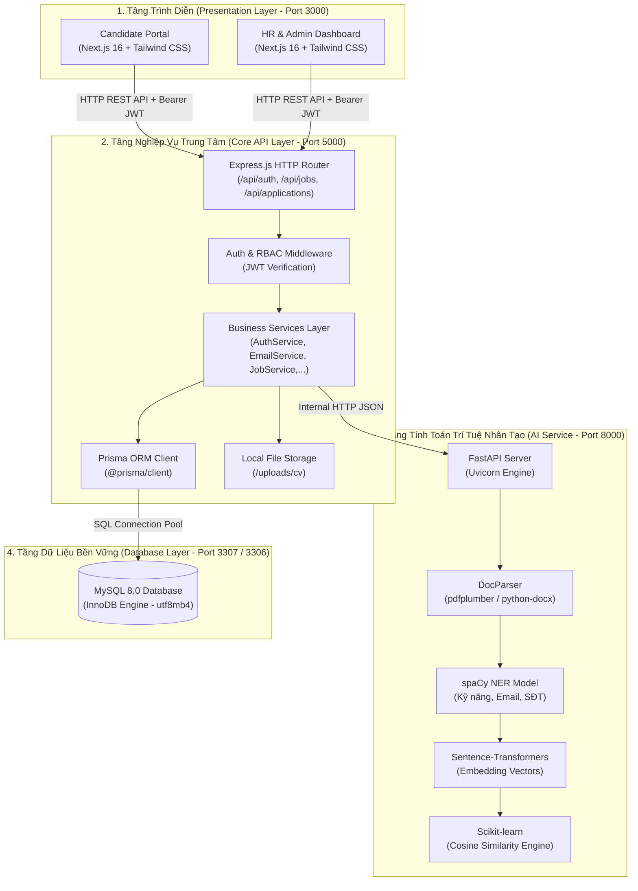
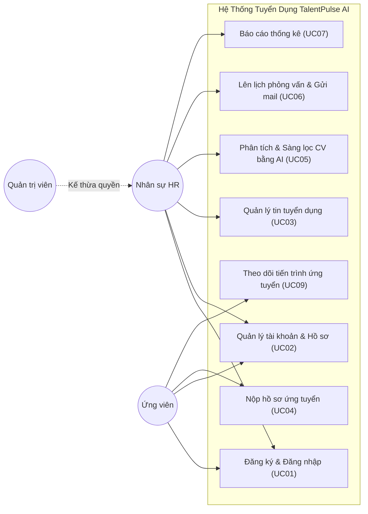
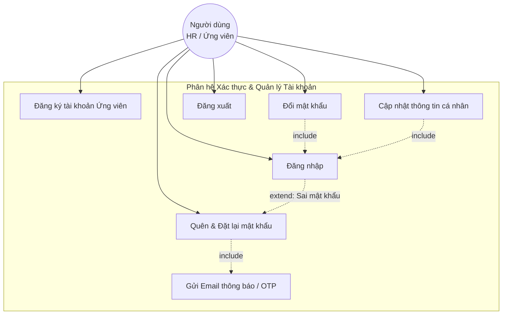
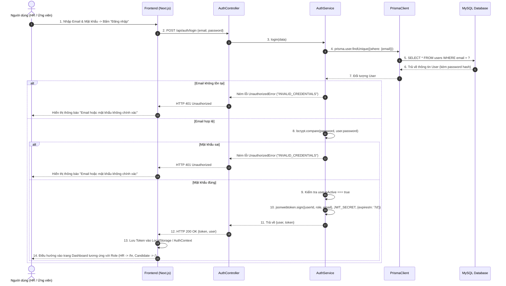
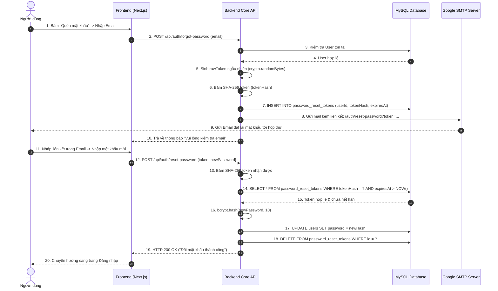
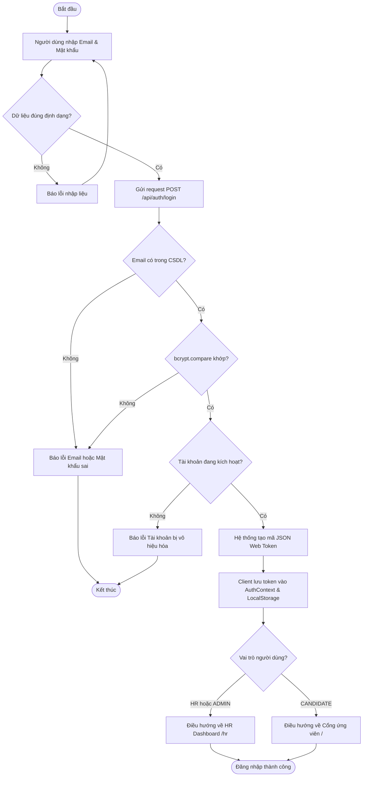
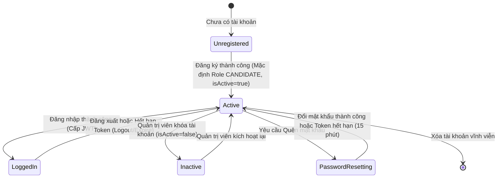
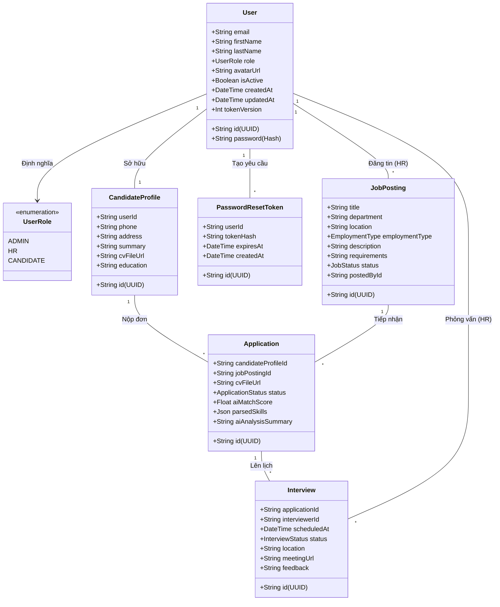

# TÀI LIỆU ÔN THI VẤN ĐÁP ĐỒ ÁN CHUYÊN NGÀNH / TỐT NGHIỆP CNTT
# HỆ THỐNG QUẢN LÝ TUYỂN DỤNG TÍCH HỢP TRÍ TUỆ NHÂN TẠO (AI-POWERED ATS)
**Dành riêng cho sinh viên:** NGUYỄN TRƯỜNG GIANG (Lớp: 74DCTT24 - Nhóm 7)  
**Đơn vị đào tạo:** Khoa Công nghệ Thông tin – Trường Đại học Công nghệ Giao thông Vận tải (UTT)  
**Giảng viên hướng dẫn:** ThS. Lê Trung Kiên  

---

## MỤC LỤC TỔNG HỢP
1. [Giới thiệu bản thân & Trách nhiệm trong đồ án](#1-giới-thiệu-bản-thân--trách-nhiệm-trong-đồ-án)
2. [Tổng quan đề tài & Mục tiêu giải pháp](#2-tổng-quan-đề-tài--mục-tiêu-giải-pháp)
3. [Kiến trúc hệ thống & Ngôn ngữ, Công nghệ sử dụng](#3-kiến-trúc-hệ-thống--ngôn-ngữ-công-nghệ-sử-dụng)
4. [Chi tiết phân hệ của Nguyễn Trường Giang (Module Auth, User, RBAC & Integration)](#4-chi-tiết-phân-hệ-của-nguyễn-trường-giang)
5. [Tập hợp biểu đồ UML chuẩn theo báo cáo Đồ án](#5-tập-hợp-biểu-đồ-uml-chuẩn-theo-báo-cáo-đồ-án)
   - [5.1. Biểu đồ Use Case tổng quát & Chi tiết](#51-biểu-đồ-use-case)
   - [5.2. Biểu đồ Tuần tự (Sequence Diagram)](#52-biểu-đồ-tuần-tự-sequence-diagram)
   - [5.3. Biểu đồ Hoạt động (Activity Diagram)](#53-biểu-đồ-hoạt-động-activity-diagram)
   - [5.4. Biểu đồ Trạng thái (State Machine Diagram)](#54-biểu-đồ-trạng-thái-state-machine-diagram)
   - [5.5. Biểu đồ Lớp (Class Diagram) & Schema CSDL](#55-biểu-đồ-lớp-class-diagram--schema-csdl)
6. [Quy trình đóng gói & Vận hành Docker Container](#6-quy-trình-đóng-gói--vận-hành-docker-container)
7. [Bộ câu hỏi vấn đáp trọng tâm & Kịch bản trả lời xuất sắc (Q&A)](#7-bộ-câu-hỏi-vấn-đáp-trọng-tâm--kịch-bản-trả-lời-xuất-sắc)

---

## 1. GIỚI THIỆU BẢN THÂN & TRÁCH NHIỆM TRONG ĐỒ ÁN

### 1.1. Lời mở đầu khi bước vào bàn vấn đáp (Kịch bản 30 giây ấn tượng):
> *"Kính thưa Thầy/Cô trong Hội đồng chấm thi vấn đáp, em tên là **Nguyễn Trường Giang**, sinh viên lớp 74DCTT24, đại diện Nhóm 7 thực hiện đề tài **'Xây dựng Hệ thống Quản lý Tuyển dụng tích hợp Trí tuệ Nhân tạo hỗ trợ phân tích và sàng lọc CV (AI-Powered ATS)'**.*  
> *Trong nhóm, em đảm nhiệm vai trò **Chịu trách nhiệm phân hệ Xác thực, Phân quyền người dùng (Authentication & RBAC), Quản lý tài khoản, Tích hợp giao diện người dùng (Candidate & HR Portal) và Đóng gói toàn bộ hệ thống bằng Docker Container hóa**.*  
> *Hôm nay, em xin phép được báo cáo chi tiết về kiến trúc tổng thể của hệ thống cũng như luồng hoạt động chi tiết trong phân hệ mà em phụ trách."*

### 1.2. Phân công nhiệm vụ các thành viên trong Nhóm 7:
- **Nguyễn Trường Giang (Bạn):** Phân hệ Xác thực & Phân quyền (`Authentication`, `RBAC`), Quản lý tài khoản & Hồ sơ (`User & Candidate Profile`), Quản lý phiên (`JWT, Session, Refresh/Logout`), Tích hợp giao diện Candidate & HR, Docker hóa toàn bộ dự án (`Docker Compose`, `MySQL Init UTF-8`).
- **Nguyễn Xuân Bách:** Quản lý Tin tuyển dụng (`Job Management`), Tạo JD, Đăng tin, Đóng/Mở chiến dịch.
- **Trần Hữu Mạnh:** Phân hệ Trí tuệ nhân tạo (`AI Service`), Trích xuất văn bản CV (PDF/DOCX), spaCy NER, Sentence-Transformers, tính Cosine Similarity.
- **Nguyễn Quốc Anh:** Quản lý Tiếp nhận hồ sơ CV (`Application Module`), Nộp đơn ứng tuyển, Upload file CV.
- **Kiều Trung Kiên:** Phân hệ Lịch phỏng vấn (`Interview Module`) và Quy trình tuyển dụng (`Recruitment Workflow Kanban`).

---

## 2. TỔNG QUAN ĐỀ TÀI & MỤC TIÊU GIẢI PHÁP

### 2.1. Đặt vấn đề thực tế:
- Doanh nghiệp tiếp nhận từ **200 – 500 CV/chiến dịch** qua nhiều kênh phân tán (Email, mạng xã hội, web tuyển dụng).
- Nhân sự (HR) mất **60% - 70% thời gian** đọc lướt thủ công, dẫn đến mệt mỏi, đánh giá cảm tính và bỏ sót ứng viên tiềm năng.
- Ứng viên nộp hồ sơ không nhận được phản hồi kịp thời, gây trải nghiệm xấu.

### 2.2. Giải pháp của hệ thống TalentPulse AI:
- **Tập trung hóa (All-in-One ATS):** Quản lý khép kín từ Đăng tin -> Nhận CV -> Sàng lọc tự động bằng AI -> Phỏng vấn -> Gửi Offer.
- **Trí tuệ nhân tạo (AI/NLP Matching):** Tự động bóc tách kỹ năng, học vấn bằng spaCy NER và dùng mô hình ngôn ngữ Sentence-Transformers đo độ tương đồng ngữ nghĩa vector giữa CV và JD.
- **Tự động hóa thông báo:** Tự động gửi Email thông báo mã OTP đặt lại mật khẩu, thư mời phỏng vấn có đính kèm Google Meet.

---

## 3. KIẾN TRÚC HỆ THỐNG & NGÔN NGỮ, CÔNG NGHỆ SỬ DỤNG

### 3.1. Mô hình kiến trúc (Architecture Pattern)
Hệ thống được xây dựng theo mô hình **Kiến trúc Dịch vụ Phân tách (Decoupled Services Architecture)** gồm 3 tầng độc lập:

### 3.2. Bảng tổng hợp công nghệ & Ngôn ngữ lập trình

| Thành phần | Ngôn ngữ / Nền tảng | Thư viện & Framework chính | Vai trò chính |
|---|---|---|---|
| **Frontend** | TypeScript / JavaScript | **Next.js 16 (React 19)**, Tailwind CSS v4, Lucide Icons, Material Symbols | Xây dựng giao diện Responsive, quản lý Client State, Token Storage |
| **Core API** | TypeScript / Node.js 20 | **Express.js**, Prisma ORM, bcryptjs, jsonwebtoken, nodemailer, multer | Điều phối toàn bộ nghiệp vụ, xác thực JWT, phân quyền RBAC, lưu trữ |
| **AI Service** | Python 3.11 | **FastAPI**, Uvicorn, spaCy (NER), Sentence-Transformers, Scikit-learn, pdfplumber | Microservice phi trạng thái (Stateless), bóc tách CV và so khớp ngữ nghĩa |
| **Cơ sở dữ liệu** | SQL | **MySQL 8.0** (InnoDB, utf8mb4_unicode_ci) | Lưu trữ người dùng, tin tuyển dụng, hồ sơ ứng viên, lịch phỏng vấn |
| **DevOps & Đóng gói** | YAML, Dockerfile | **Docker & Docker Compose** | Đóng gói toàn bộ ứng dụng chạy cô lập, tự động seed database khởi tạo |

---

## 4. CHI TIẾT PHÂN HỆ CỦA NGUYỄN TRƯỜNG GIANG

Phân hệ bạn phụ trách là **xương sống bảo mật và kiểm soát truy cập của toàn hệ thống**.

### 4.1. Các chức năng nghiệp vụ phụ trách:
1. **Đăng ký tài khoản ứng viên (`POST /api/auth/register`):**
   - Kiểm tra định dạng Email, độ mạnh mật khẩu (tối thiểu 6 ký tự).
   - Mã hóa mật khẩu bảo mật 1 chiều bằng thuật toán **bcrypt** với Salt round = 10.
   - Sử dụng Prisma Transaction tự động tạo song song bản ghi `User` (Role `CANDIDATE`) và `CandidateProfile` rỗng sẵn sàng cho ứng viên cập nhật.
2. **Đăng nhập hệ thống (`POST /api/auth/login`):**
   - Xác thực Email và đối soát mật khẩu đã mã hóa bằng `bcrypt.compare()`.
   - Kiểm tra trạng thái kích hoạt tài khoản (`isActive === true`).
   - Ký và phát hành mã xác thực **JSON Web Token (JWT)** chứa Payload: `userId`, `email`, `role`, `tokenVersion` với hạn dùng 7 ngày (`7d`).
3. **Phân quyền người dùng (Role-Based Access Control - RBAC):**
   - Quản trị 3 vai trò độc lập:
     - `CANDIDATE` (Ứng viên): Xem việc, nộp CV, quản lý hồ sơ của chính mình.
     - `HR` (Nhà tuyển dụng): Đăng tin, duyệt hồ sơ, xem kết quả AI, lên lịch phỏng vấn.
     - `ADMIN` (Quản trị viên): Toàn quyền quản trị hệ thống, cấp quyền người dùng.
   - Xây dựng 2 lớp bảo vệ:
     - **Backend:** `auth.middleware.ts` (kiểm tra Bearer token) kết hợp `role.middleware.ts` (chặn 403 Forbidden nếu không đủ quyền).
     - **Frontend:** Component `<RoleGuard allowedRoles={['HR', 'ADMIN']}>` bọc bảo vệ các route nhạy cảm.
4. **Quên & Đặt lại mật khẩu (`Forgot & Reset Password Flow`):**
   - `POST /api/auth/forgot-password`: Tạo Token ngẫu nhiên bằng `crypto.randomBytes(32)`, băm SHA-256 lưu vào bảng `password_reset_tokens` với thời hạn 15 phút, gửi link qua Email bằng `nodemailer` (Google SMTP TLS).
   - `POST /api/auth/reset-password`: Xác thực token băm, đối chiếu hạn dùng, cập nhật mật khẩu mới và hủy token đã dùng.
5. **Đăng xuất an toàn (`POST /api/auth/logout`):**
   - Tăng `tokenVersion` trong cơ sở dữ liệu để vô hiệu hóa toàn bộ Token cũ đã phát hành, đồng thời xóa thông tin lưu trữ tại LocalStorage/Cookie của Client.
6. **Quản lý Hồ sơ cá nhân (`GET /api/auth/profile` & `PUT /api/auth/profile`):**
   - Cho phép người dùng cập nhật thông tin cá nhân (Họ tên, SĐT, Địa chỉ, Avatar).

---

## 5. TẬP HỢP BIỂU ĐỒ UML CHUẨN THEO BÁO CÁO ĐỒ ÁN

### 5.1. Biểu đồ Use Case

#### Use Case Tổng quát Hệ thống

#### Use Case Chi tiết Phân hệ Xác thực (Module Giang phụ trách)

---

### 5.2. Biểu đồ Tuần tự (Sequence Diagram)

#### 1. Biểu đồ tuần tự Đăng nhập hệ thống (Login Sequence)

#### 2. Biểu đồ tuần tự Quên & Đặt lại mật khẩu (Forgot & Reset Password Sequence)

---

### 5.3. Biểu đồ Hoạt động (Activity Diagram)

#### Quy trình Đăng nhập & Điều hướng phân quyền

---

### 5.4. Biểu đồ Trạng thái (State Machine Diagram)

#### Vòng đời trạng thái của Người dùng (User Lifecycle)

---

### 5.5. Biểu đồ Lớp (Class Diagram) & Schema CSDL

---

## 6. QUY TRÌNH ĐÓNG GÓI & VẬN HÀNH DOCKER CONTAINER

Một điểm cộng lớn của bạn trước hội đồng là **đã tự tay đóng gói toàn bộ hệ thống bằng Docker Compose**.

### 6.1. Cấu trúc các Container:
1. **Container `ats_mysql_dev` (Port 3307 -> 3306):**
   - Image: `mysql:8.0.41`.
   - Cấu hình character set: `utf8mb4_unicode_ci` (hỗ trợ tiếng Việt tuyệt đối).
   - Volume tự động nạp dump dữ liệu ban đầu: `./docker/mysql-init/ats_database.sql`.
2. **Container `ats_core_api` (Port 5000:5000):**
   - Multi-stage build Node.js 20-slim.
   - Cơ chế Polling connection: Có vòng lặp chờ MySQL sẵn sàng (`prisma.$queryRaw'SELECT 1'`, 25 lần) trước khi `app.listen()`.
   - Tùy chọn `allowPublicKeyRetrieval=true` và `--default-authentication-plugin=mysql_native_password` đảm bảo kết nối ổn định giữa container Node.js và MySQL.
3. **Container `ats_ai_service` (Port 8000:8000):**
   - Python 3.11-slim, chạy Uvicorn server với FastAPI.
4. **Container `ats_frontend` (Port 3000:3000):**
   - Next.js 16 Production build.

---

## 7. BỘ CÂU HỎI VẤN ĐÁP TRỌNG TÂM & KỊCH BẢN TRẢ LỜI XUẤT SẮC (Q&A)

### ❓ Câu 1: Em hãy giải thích cơ chế xác thực người dùng trong hệ thống? Tại sao lại dùng JWT thay vì Session Cookie truyền thống?
- **Trả lời chuẩn:**
  > *"Thưa Thầy/Cô, hệ thống sử dụng cơ chế **Stateless Authentication bằng JSON Web Token (JWT)**.  
  > Khi người dùng đăng nhập thành công với Email và Mật khẩu, Server sẽ tạo ra một chuỗi Token được ký điện tử (Signature) bằng thuật toán `HS256` cùng khóa bí mật `JWT_SECRET`. Token này chứa Payload gồm `userId`, `email`, `role`, và `tokenVersion`.  
  > **Lý do chọn JWT thay vì Session truyền thống:**
  > 1. **Kiến trúc phân tách (Decoupled Services):** Frontend Next.js và Backend Express chạy độc lập. JWT là stateless (phi trạng thái), Backend không cần cấp phát bộ nhớ RAM để lưu bảng session, giúp dễ dàng scale hệ thống.
  > 2. **Hiệu năng cao:** Mọi request tiếp theo chỉ cần gửi kèm Token trên Header `Authorization: Bearer <token>`, middleware backend chỉ cần giải mã kiểm tra chữ ký số mà không cần query lại CSDL ở mỗi request tĩnh."*

---

### ❓ Câu 2: Mật khẩu người dùng được bảo vệ như thế nào trong cơ sở dữ liệu? Em có lưu mật khẩu thô (plain text) không?
- **Trả lời chuẩn:**
  > *"Dạ tuyệt đối không lưu plain text. Hệ thống của em áp dụng kỹ thuật mã hóa một chiều an toàn bằng thư viện **`bcryptjs`** với hệ số `Salt Round = 10`.  
  > Thuật toán Bcrypt tự động sinh chuỗi Salt ngẫu nhiên gắn vào mật khẩu trước khi băm. Điều này giúp ngăn chặn hoàn toàn các cuộc tấn công dạng **Rainbow Table** (bảng băm tính sẵn) và tấn công vét cạn (Brute-Force). Khi kiểm tra đăng nhập, hàm `bcrypt.compare()` sẽ đối soát mật khẩu người dùng nhập với chuỗi băm trong DB mà không bao giờ cần giải mã ngược mật khẩu."*

---

### ❓ Câu 3: Làm thế nào để phân quyền (RBAC) giữa HR, Ứng viên và Quản trị viên (Admin)? Nếu một Ứng viên cố tình gọi API của HR thì hệ thống xử lý ra sao?
- **Trả lời chuẩn:**
  > *"Hệ thống áp dụng cơ chế **Bảo vệ 2 lớp (Defense in Depth)**:  
  > 1. **Tại Backend (Lớp quyết định an toàn):** Em xây dựng middleware `role.middleware.ts`. Ví dụ với route tạo việc làm `POST /api/jobs`, middleware sẽ đọc payload của JWT, nếu role không nằm trong mảng `['HR', 'ADMIN']`, hệ thống lập tức ngắt request và trả về mã lỗi **HTTP 403 Forbidden** cùng thông báo không có quyền truy cập. Do đó dù ứng viên dùng Postman gửi request cũng không thể can thiệp.  
  > 2. **Tại Frontend (Lớp trải nghiệm người dùng):** Em xây dựng HOC Component `<RoleGuard allowedRoles={[...]}>`. Nếu người dùng không đúng quyền, giao diện tự động chặn render và redirect người dùng về trang chủ hoặc trang đăng nhập."*

---

### ❓ Câu 4: Chức năng Quên mật khẩu hoạt động như thế nào? Em bảo mật liên kết reset mật khẩu ra sao?
- **Trả lời chuẩn:**
  > *"Quy trình quên mật khẩu được bảo vệ 3 tầng:  
  > 1. **Sinh Token ngẫu nhiên:** Dùng hàm an toàn mật mã học `crypto.randomBytes(32)` để sinh một chuỗi ngẫu nhiên dài 64 ký tự hex.  
  > 2. **Lưu trữ dạng băm:** Token gửi qua email cho người dùng là token thô, nhưng trong CSDL bảng `password_reset_tokens` em chỉ lưu giá trị băm **SHA-256** của token đó. Nếu CSDL bị lộ, hacker cũng không thể dùng giá trị băm này để reset mật khẩu.  
  > 3. **Ràng buộc thời gian & Một lần dùng:** Token chỉ có giá trị trong **15 phút**. Khi người dùng đổi mật khẩu thành công, bản ghi token sẽ bị xóa ngay lập tức khỏi database để không thể tái sử dụng."*

---

### ❓ Câu 5: Hệ thống hoạt động phối hợp giữa Core API (Node.js) và AI Service (Python) như thế nào?
- **Trả lời chuẩn:**
  > *"Thưa Thầy/Cô, hai dịch vụ hoạt động theo mô hình **Phân tách trách nhiệm (Separation of Concerns)**:  
  > - **Core API (Node.js/Express):** Là trung tâm điều phối nghiệp vụ. Khi ứng viên nộp hồ sơ, Core API nhận file qua `multer`, lưu vào thư mục `uploads/cv/` và lưu bản ghi vào MySQL.  
  > - **AI Service (Python/FastAPI):** Là worker tính toán phi trạng thái (Stateless). Khi HR bấm 'Sàng lọc AI', Core API gọi HTTP POST sang AI Service mang theo đường dẫn CV và nội dung JD. AI Service sử dụng `pdfplumber` đọc text, `spaCy` bóc tách kỹ năng và `Sentence-Transformers` tính toán độ tương đồng Cosine, rồi trả về JSON kết quả gồm `% Match Score` và các kỹ năng phát hiện được.  
  > - Core API nhận kết quả và lưu cập nhật vào bảng `applications` trong MySQL để HR theo dõi trên Dashboard."*

---

### ❓ Câu 6: Trong quá trình làm dự án, em đã giải quyết những khó khăn kỹ thuật nào nổi bật nhất?
- **Trả lời chuẩn (Thực tế từ dự án của bạn):**
  > *"Dạ, em đã trực tiếp giải quyết 3 thách thức kỹ thuật lớn:  
  > 1. **Lỗi bất đồng bộ kết nối Database khi Container hóa (Race Condition):** Khi chạy `docker-compose up`, MySQL cần thời gian chạy init script và skip-networking, khiến backend Node.js khởi động trước bị crash. Em đã viết một **vòng lặp Polling Retry (25 lần, mỗi lần cách nhau 2 giây)** kiểm tra kết nối CSDL trước khi mở cổng server.  
  > 2. **Vấn đề mã hóa ký tự Tiếng Việt (Encoding & Mojibake):** File dump SQL xuất từ Windows PowerShell bị dính encoding UTF-16LE làm MySQL Linux trong Docker không nhận diện được bảng và lỗi font tiếng Việt. Em đã chuyển đổi chuẩn hóa toàn bộ file dump sang **UTF-8 mb4**, đảm bảo dữ liệu hiển thị tiếng Việt hoàn hảo trên mọi môi trường.  
  > 3. **Khắc phục lỗi tràn giao diện (CSS Header Overlap):** Do thanh Header cố định (`fixed top-0`), nội dung các trang con bị che mất tiêu đề và nút chức năng. Em đã chuẩn hóa lại padding của thẻ `main` trong `HrLayout.tsx` thành `pt-24`, giúp tất cả các trang HR hiển thị chuẩn xác, thoáng đãng trên mọi độ phân giải."*

---

## LỜI CHÚC DÀNH CHO GIANG:
> **Bí quyết thi điểm cao:** Trả lời tự tin, rõ ràng, nhìn thẳng vào Thầy/Cô. Khi được hỏi về code, hãy mở trực tiếp file `backend/core-api/src/services/auth.service.ts` và `frontend/src/components/auth/role-guard.tsx` ra để chỉ dẫn chứng. Chúc bạn thi vấn đáp thật tự tin và đạt điểm A+ xuất sắc!
